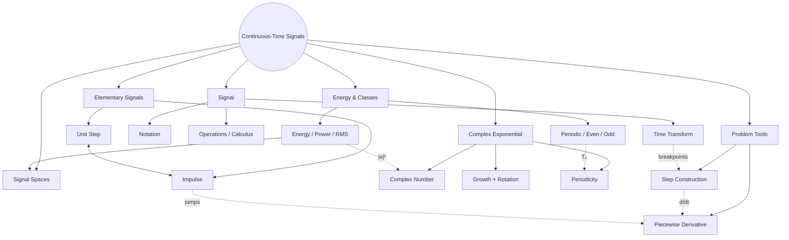
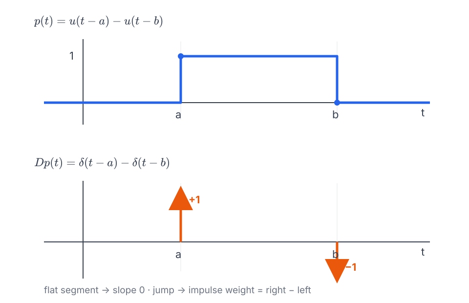
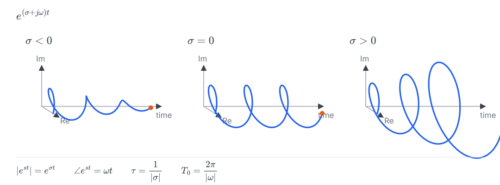
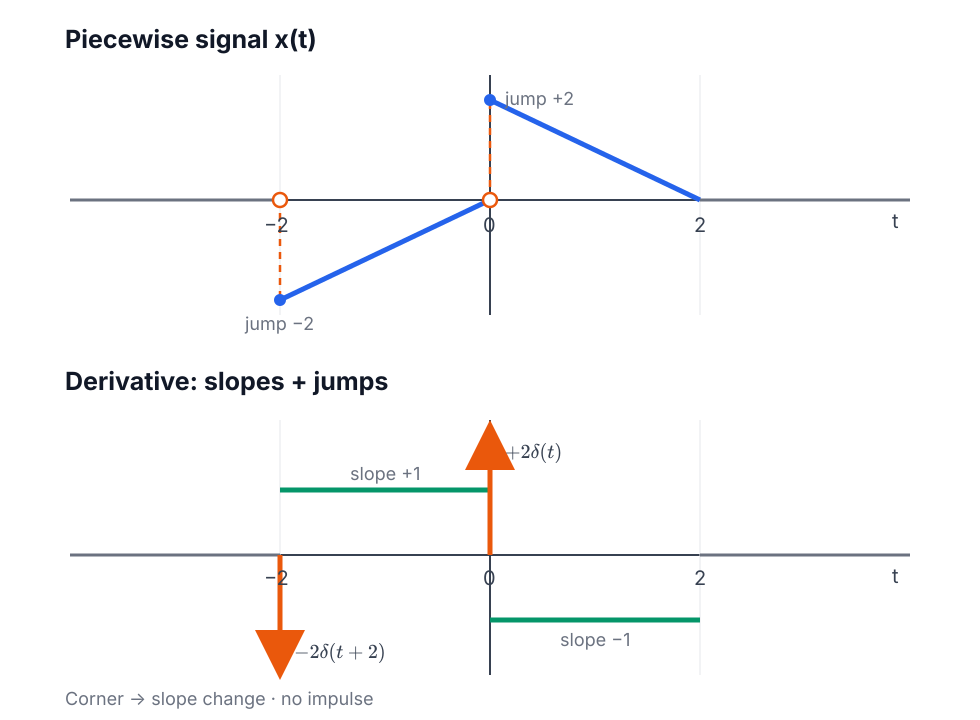

<!-- AI-assisted draft: Signals_and_System_02Oct.pdf, Chapter 2, pp. 25-41 + user discussion. -->

# Chapter 2 — Continuous-Time Signals

Signals_and_System_02Oct.pdf · pp. 25-41

---

<a id="map"></a>

## Map



Jump: [Signal](#signal) · [Energy & classes](#energy-classes) · [Elementary signals](#elementary-signals) · [Complex exponential](#complex-exponential) · [Problem tools](#problem-tools) · [Signal spaces](#signal-spaces)

---

<a id="signal"></a>

## Signal

<a id="notation"></a>

**Notation**

```math
x:\mathbb R\to\mathbb R
\qquad\text{or}\qquad
x:\mathbb R\to\mathbb C
```

- $x$: whole signal
- $x(t)$: value at $t$
- domain: allowed inputs
- codomain: allowed outputs
- range: actual outputs

```math
\mathrm{range}(x)\subseteq\mathrm{codomain}(x)
```

Symbols: $\forall$ all · $\exists$ exists · $\in$ belongs · $:$ such that.

Sound: magnitude ↔ volume · time scale ↔ pitch · $x(-t)$ ↔ reverse.

<a id="operations"></a>

**Operations / calculus**

```math
(cx)(t)=cx(t),\qquad
(x+y)(t)=x(t)+y(t),\qquad
(xy)(t)=x(t)y(t)
```

```math
\dot x(t)=\frac{dx}{dt}(t)
```

```math
\frac{d}{dt}x(g(t))=x'(g(t))g'(t),
\qquad
\frac{d}{dt}[f(t)g(t)]=f'g+fg'
```

Chain rule → transformed argument · product rule → signal × window.

```math
y(t)=\int_{-\infty}^{t}x(\tau)\thinspace d\tau
```

- $\tau$: dummy variable
- $t$: observation time
- variable limit → signal
- fixed limits → number

$t\in\mathbb R$: any real $t$; not $t=\infty$.

↔ [energy](#energy) · [step/impulse](#elementary-signals)

Practice: [positive $f$ vs increasing $g$](./chapter-2-representative-problems.md#p1-positive-vs-increasing)

<a id="time-transform"></a>

**Time transform**

[缩放 / 翻转 / 平移 · 交互图](https://zgqmoe.github.io/EEEN-20131-Notes/visuals/signals-lab.html#transform)

```math
\boxed{x_{a,t_{0}}(t)=x\negthinspace \left(a(t-t_{0})\right)}
```

Original point $\tau$:

```math
\boxed{t=t_{0}+\frac{\tau}{a}}
```

- $|a|>1$: narrower
- $0<|a|<1$: wider
- $a<0$: reversal
- $t_{0}>0$: right
- $t_{0}<0$: left

Method: breakpoints $\tau$ → transform → sort → same heights.

↔ [problem tools](#problem-tools)

Practice: [breakpoint transform](./chapter-2-representative-problems.md#p3-time-transform)

---

<a id="energy-classes"></a>

## Energy & Classes

<a id="energy"></a>

**Energy / power / RMS**

Circuit origin:

```math
p(t)=\frac{v^{2}(t)}{R},
\qquad
E(t)=\int_{-\infty}^{t}\frac{v^{2}(\tau)}{R}\thinspace d\tau
```

```math
\boxed{E_\infty=\int_{-\infty}^{\infty}|x(t)|^{2}dt}
```

```math
E_\infty<\infty
\iff
\text{finite energy}
```

$\infty$: whole time axis; not necessarily infinite answer.

```math
\boxed{
P_\infty=
\lim_{T\to\infty}
\frac{1}{2T}\int_{-T}^{T}|x(t)|^{2}dt
}
```

```math
x_{\mathrm{RMS}}=\sqrt{P_\infty}
```

```math
E_\infty<\infty\Rightarrow P_\infty=0
```

Checks:

- bounded $x$ $\nRightarrow$ finite energy
- complex: $|x|^{2}=xx^{\ast}$
- even integrand: $\int_{-A}^{A}f=2\int_{0}^{A} f$

↔ [complex-number tools](#complex-number) · [periodic power](#classes)

Practice: [energy / power / RMS](./chapter-2-representative-problems.md#p2-energy-power-rms) · [impulse → energy](./chapter-2-representative-problems.md#p5-impulse-step-energy)

<a id="classes"></a>

**Periodic / aperiodic**

```math
\mathcal P=
\lbrace T>0:x(t+T)=x(t),\ \forall t\in\mathbb R\rbrace
```

```math
\boxed{T_{0}=\min\mathcal P}
```

Constant signal: every $T>0$ works → no smallest $T$ → no $T_{0}$.

Aperiodic: $\mathcal P=\varnothing$.

Nonzero periodic signal:

```math
E_\infty=\infty
```

```math
P_\infty=
\frac{1}{T_{0}}
\int_{t_{0}}^{t_{0}+T_{0}}|x(t)|^{2}dt
```

```math
A\cos(\omega t+\phi):
\qquad
P_\infty=\frac{A^{2}}{2}
```

```math
Ae^{j(\omega t+\phi)}:
\qquad
P_\infty=|A|^{2}
```

**Even / odd**

```math
x(t)=x(-t)
\qquad\text{even}
```

```math
x(t)=-x(-t)
\qquad\text{odd}
```

$\cos$: even · $\sin$: odd.

```math
f\text{ odd}
\Rightarrow
\int_{-A}^{A}f(t)\thinspace dt=0
```

↔ [complex periodicity](#complex-periodicity)

Practice: [$\sigma$ vs periodicity](./chapter-2-representative-problems.md#p4-complex-periodicity)

---

<a id="elementary-signals"></a>

## Elementary Signals

<a id="step"></a>

**Unit step**

$u$: Heaviside step.

```math
u(t)=
\begin{cases}
0,&t<0\\
1,&t\ge0
\end{cases}
```

```math
u(t-a):\text{ open at }a
\qquad
u(a-t):\text{ close at }a
```

```math
x(t)u(t-a):
\text{ keep }t\ge a
```

Pulse $[a,b)$:

```math
\boxed{u(t-a)-u(t-b)}
```

Also:

```math
u(t-a)u(b-t)
```

Endpoint only: depends on $u(0)$.

$u(0)=1$ · endpoint convention · same ordinary integrals

↔ [impulse](#impulse) · [step construction](#step-construction)

Practice: [two-step pulse](./chapter-2-representative-problems.md#p6-pulse-forms) · [level changes](./chapter-2-representative-problems.md#p7-step-construction)

<a id="impulse"></a>

**Dirac delta**

```math
\delta_{n}(t)=
\begin{cases}
n,&|t|\le\dfrac{1}{2n}\\
0,&\text{otherwise}
\end{cases}
,\qquad
\int_{-\infty}^{\infty}\delta_{n}(t)dt=1
```

$n\to\infty$: width $\to0$ · height $\to\infty$ · area $=1$.

```math
\int_{-\infty}^{\infty}\delta(t-a)\thinspace dt=1
```

Not an ordinary pointwise function.

Sifting:

```math
\boxed{
\int_{-\infty}^{\infty}f(t)\delta(t-a)\thinspace dt=f(a)
}
```

```math
\boxed{f(t)\delta(t-a)=f(a)\delta(t-a)}
```

```math
\boxed{
\delta\negthinspace \left(c(t-a)\right)
=\frac{1}{|c|}\delta(t-a)
}
```

$\frac{1}{|c|}$: unit area

Step ↔ impulse:

```math
\boxed{
u(t-a)=\int_{-\infty}^{t}\delta(\tau-a)\thinspace d\tau
}
```

```math
\boxed{
\frac{d}{dt}u(t-a)=\delta(t-a)
}
```

```math
\frac{d}{dt}u(c(t-a))
=c\delta(c(t-a))
=\frac{c}{|c|}\delta(t-a)
\qquad(c\ne0)
```



Future:

```math
\int_{T}^\infty\delta(t-a)\thinspace dt=u(a-T)=u(-(T-a))
```

Impulse arrow: position $a$ · label $=$ weight/area.

↔ [calculus](#operations) · [piecewise derivative](#piecewise-derivative)

Practice: [impulse → step → energy](./chapter-2-representative-problems.md#p5-impulse-step-energy) · [delta properties](./chapter-2-representative-problems.md#p9-delta-properties)

---

<a id="complex-exponential"></a>

## Complex Exponential

<a id="complex-number"></a>

**Complex-number tools**

```math
z=x+jy=re^{j\theta}
```

```math
r=|z|=\sqrt{x^{2}+y^{2}},
\qquad
\theta=\mathrm{atan2}(y,x)
```

```math
z^{\ast}=x-jy,
\qquad
\boxed{|z|^{2}=zz^{\ast}}
```

```math
|e^{j\theta}|=1
```

<a id="complex-signal"></a>

**Signal**

```math
s=\sigma+j\omega
```

ODE building block.

```math
\boxed{
e^{st}
=
e^{\sigma t}
\left[\cos(\omega t)+j\sin(\omega t)\right]
}
```

- $\sigma$: magnitude growth/decay
- $\omega$: rotation/oscillation

```math
|e^{st}|=e^{\sigma t},
\qquad
\angle e^{st}=\omega t
```

```math
\tau=\frac{1}{|\sigma|}
```

$\sigma<0$: $e^{\sigma\tau}=e^{-1}$ · $\sigma>0$: $e^{\sigma\tau}=e$.

```math
f=\frac{|\omega|}{2\pi},
\qquad
T_{0}=\frac{2\pi}{|\omega|}
```

```math
\cos(\omega t)=\frac{e^{j\omega t}+e^{-j\omega t}}{2}
```

```math
\sin(\omega t)=\frac{e^{j\omega t}-e^{-j\omega t}}{2j}
```

$\sigma<0$: inward spiral · $\sigma=0$: circle · $\sigma>0$: outward spiral.



Practice: [complex magnitude / power](./chapter-2-representative-problems.md#p2-energy-power-rms) · [$\sigma$ vs constant magnitude](./chapter-2-representative-problems.md#p4-complex-periodicity)

<a id="complex-periodicity"></a>

**Periodicity**

```math
Ae^{(\sigma+j\omega)t}
\text{ periodic}
\iff
A\ne0,\ \sigma=0,\ \omega\ne0
```

```math
T_{0}=\frac{2\pi}{|\omega|}
```

```math
Ae^{c+j\omega t}
=Ae^{c} e^{j\omega t}
\quad\text{periodic}
```

```math
Ae^{(c+j\omega)t}
=Ae^{ct}e^{j\omega t}
\quad\text{not periodic if }c\ne0
```

Sinusoid sum:

```math
\frac{\omega_{i}}{\omega_{j}}\in\mathbb Q
\quad\forall i,j
```

then common $T_{0}$ exists.

↔ [periodic signals](#classes) · [energy](#energy)

---

<a id="problem-tools"></a>

## Problem Tools

<a id="step-construction"></a>

**Piecewise constant → steps**

At $t_{k}$:

```math
J_{k}=\text{new level}-\text{old level}
```

```math
\boxed{x(t)=\text{initial level}+\sum_{k}J_{k}u(t-t_{k})}
```

↔ [unit step](#step) · [derivative](#piecewise-derivative)

Practice: [level-change method](./chapter-2-representative-problems.md#p7-step-construction)

<a id="piecewise-derivative"></a>

**Piecewise derivative**

For differentiable $f$ and $a<b$:

```math
\boxed{
\begin{aligned}
\frac{d}{dt}\lbrace f(t)[u(t-a)-u(t-b)]\rbrace
={}&f'(t)[u(t-a)-u(t-b)]\\
&+f(a)\delta(t-a)-f(b)\delta(t-b)
\end{aligned}}
```

```math
\boxed{
Dx=
x'_{\mathrm{ordinary}}
+
\sum_{k}
\left[x(t_{k}^+)-x(t_{k}^-)\right]\delta(t-t_{k})
}
```

- sloped segment → ordinary slope
- constant segment → $0$
- jump → impulse
- continuous corner → no impulse in $Dx$

Reason:

```math
\int_{t_{k}-\varepsilon}^{t_{k}+\varepsilon}Dx(t)\thinspace dt
\xrightarrow{\varepsilon\to0}
x(t_{k}^+)-x(t_{k}^-)
```

Pulse:

```math
u(t-a)-u(t-b)
\xrightarrow{d/dt}
\delta(t-a)-\delta(t-b)
```



↔ [step](#step) · [impulse](#impulse)

Practice: [rectangular pulse](./chapter-2-representative-problems.md#p6-pulse-forms) · [slopes + jumps](./chapter-2-representative-problems.md#p8-piecewise-derivative) · [window derivative quiz](./chapter-2-representative-problems.md#p10-window-derivative)

**Fast checks**

- $f(t)>0$ $\nRightarrow$ $f$ increasing
- $f\ge0$ and $g(T)=\int_{-T}^{T}f(t)dt$ → $g$ nondecreasing
- $|e^{j\theta}|=1$
- transform point: $t=t_{0}+\tau/a$
- jump weight: right $-$ left
- delta product: sample at impulse location
- energy: support → split → $|x|^{2}$ → integrate

---

<a id="signal-spaces"></a>

## Signal Spaces

Impulse as functional:

```math
\delta:C_{0}\to\mathbb R,
\qquad
f\mapsto f(0)
```

$C_{0}$: functions continuous at $0$.

```math
L^{2}=
\left\lbrace
x:\int_{-\infty}^{\infty}|x(t)|^{2}dt<\infty
\right\rbrace
```

```math
E_\infty=\|x\|_{2}^{2}
```

```math
L_{e}^{2}=
\left\lbrace
x:\int_{-\infty}^{T}|x(t)|^{2}dt<\infty,\ \forall T
\right\rbrace
```

Real signals:

```math
\langle x,y\rangle=
\int_{-\infty}^{\infty}x(t)y(t)dt
```

Complex signals:

```math
\langle x,y\rangle=
\int_{-\infty}^{\infty}x(t)y^{\ast}(t)dt
```

Real nonzero signals:

```math
\cos\theta=
\frac{\langle x,y\rangle}{\|x\|_{2}\|y\|_{2}}
```

```math
L^{1}=
\left\lbrace
x:\int_{-\infty}^{\infty}|x(t)|dt<\infty
\right\rbrace
```

↔ [energy](#energy) · [complex modulus](#complex-number) · [map](#map)
