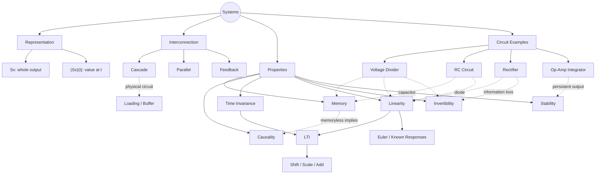

<!-- AI-assisted draft: Signals_and_System_02Oct.pdf, Chapter 3, pp. 45-53; SnS_Systems.pdf, slides 1-34; user discussion. -->

# Chapter 3 — Systems and Properties

Scope: through 3.5.6 · discussion ≠ completion / mastery

---

<a id="map"></a>

## Map



Jump: [System](#system) · [Interconnection](#interconnection) · [Properties](#properties) · [Circuits](#circuits) · [Fast checks](#fast-checks)

---

<a id="system"></a>

## System

```math
S:\mathcal X\to\mathcal Y,
\qquad
x\mapsto y=Sx
```

```math
y(t)=(Sx)(t)
```

- $x,y$: whole signals
- $Sx$: whole output signal
- $(Sx)(t)$: output value at $t$
- parameters + initial conditions: fixed parts of $S$

Rule ≠ input ≠ response pair · multiple pairs → same $S$

```math
(Sx)(t)=t\thinspace x(t-2)\quad\Rightarrow\quad (Sz)(t)=t\thinspace z(t-2)
```

New input · fixed $S$

```math
v(t)=t\thinspace x(t-2)\quad\Rightarrow\quad v(t-1)=(t-1)x(t-3)
```

Whole-signal evaluation → all time arguments

Basic systems:

```math
(Bx)(t)=x(-t)
\qquad\text{time reversal}
```

```math
(Ix)(t)=\int_{-\infty}^{t}x(\tau)\thinspace d\tau
\qquad\text{integration}
```

```math
(Dx)(t)=\frac{dx}{dt}(t)
\qquad\text{differentiation}
```

```math
(P_{k}x)(t)=kx(t)
\qquad\text{gain}
```

---

<a id="interconnection"></a>

## Interconnection

**Cascade**

```math
v=S_{1}x,
\qquad
y=S_{2}v
```

```math
\boxed{S_{\mathrm{c}}=S_{2}\circ S_{1}}
```

Right first · composition ≠ multiplication

**Parallel**

```math
\boxed{S_{\mathrm{p}}=S_{1}+S_{2}}
```

```math
((S_{1}+S_{2})x)(t)
=(S_{1}x)(t)+(S_{2}x)(t)
```

**Feedback**

```math
e=x+\sigma S_{2}y,
\qquad
y=S_{1}e,
\qquad
\sigma\in\lbrace -1,+1\rbrace
```

```math
y=S_{1}(x+\sigma S_{2}y)
```

Well posed:

```math
\forall x,\ \exists!\thinspace y
```

Input → unique output

<a id="loading"></a>

**Physical cascade: loading**

Isolated divider:

```math
v_{1}=\frac{R_{2}}{R_{1}+R_{2}}v_{\mathrm{in}}
```

Second divider attached:

```math
R_{2}\longrightarrow R_{2}\parallel(R_{3}+R_{4})
```

```math
v_{1}=
\frac{R_{2}\parallel(R_{3}+R_{4})}
{R_{1}+R_{2}\parallel(R_{3}+R_{4})}v_{\mathrm{in}}
```

Loading → changed mapping

Voltage follower:

```math
R_{\mathrm{in}}\to\infty,
\qquad
R_{\mathrm{out}}\to0,
\qquad
\text{gain}=1
```

Buffer → isolation → cascade


---

<a id="properties"></a>

## Properties

<a id="property-method"></a>

**One workflow**

Rule + domain → probe → $S$ → comparison → evidence

Proof: $\forall$ inputs · disproof: $\exists$ counterexample
Graphs: contradiction → impossible · no contradiction → possible

**Present · future · shift · superposition**


Memoryless ⊂ causal · LTI = linear ∩ TI

<a id="memory"></a>

**Memory**

Present only

$\forall x_{1},x_{2},t$:

```math
x_{1}(t)=x_{2}(t)
\Rightarrow
(Sx_{1})(t)=(Sx_{2})(t)
```

Pointwise form:

```math
(Sx)(t)=f(t,x(t))
```

Time-independent case:

```math
(Sx)(t)=f(x(t))
```

Counterexample: same present input · different output

Present term ≠ present-only dependence
Past / future → memory · shape ≠ test

Gain:

```math
(P_{k}x)(t)=kx(t)
```

Saturation:

```math
\mathrm{sat}_{L}(x)=
\begin{cases}
-L,&x<-L\\
x,&-L\le x\le L\\
L,&x>L
\end{cases}
```

Memory: dependence on $x(\tau)$, $\tau\ne t$

```math
x(t-1):\text{ past memory}
\qquad
x(t+1):\text{ future memory}
```

Backward system:

```math
(Bx)(t)=x(-t)
```

- $t<0$: reads future $-t>t$
- $t>0$: reads past $-t<t$
- overall: has memory


Practice: [nine systems](./chapter-3-representative-problems.md#p8-system-properties)

<a id="causality"></a>

**Causality**

Past + present

$\forall x_{1},x_{2},t_{0}$:

```math
x_{1}(\tau)=x_{2}(\tau)\quad\forall\tau\le t_{0}
\quad\Rightarrow\quad
(Sx_{1})(t_{0})=(Sx_{2})(t_{0})
```

Future → noncausal

Counterexample: same history · different current output

Same present ≠ same history
Onset alone ≠ causality test · offsets / initial conditions

```math
\text{memoryless}\Rightarrow\text{causal},
\qquad
\text{noncausal}\Rightarrow\text{has memory}
```

Unrestricted inputs: $y(t)=x(g(t))$ · causal iff $g(t)\le t$, $\forall t$

```math
t=-3:\quad x(t/3)=x(-1),\quad -1>-3
\quad\Rightarrow\quad\text{noncausal}
```

**Negative times included** · read time vs present time

Differentiator, differentiable inputs:

```math
x'(t)=\lim_{h\to0^+}\frac{x(t)-x(t-h)}h
```

Past-side limit → causal · value ≠ slope → memory

Nearby ≠ future · causal ≠ ideal realisation

Practice: [S8 / S9](./chapter-3-representative-problems.md#p8-system-properties) · [graph tests](./chapter-3-representative-problems.md#p13-graph-tests)

<a id="time-invariance"></a>

**Time Invariance**

Same delay · same shape

$z(t)=x(t-d)$ · $y=Sx$

```math
A(t)=(Sz)(t),\qquad B(t)=y(t-d)
```

```math
\boxed{(Sz)(t)=(Sx)(t-d)\quad\forall x,t,d}
```

Input shifted → fixed $S$ · output shifted → all time arguments

Counterexample: $x,d,t_{0}$ · $A(t_{0})\ne B(t_{0})$

One passing probe ≠ TI · system delay ≠ test delay
Changing output ≠ TV · explicit $t$ ≠ TV proof

- read times → $x(t)=t$ · gains → $x(t)=1$
- gate → conditions + branches
- input gate alone ≠ TI
- branch condition ≠ domain / range / codomain

```math
y(t)=x(2t):\quad
(Sz)(t)=x(2t-d),\qquad y(t-d)=x(2t-2d)
```

Input shift $d$ → output shift $\frac{d}{2}$ · TV · constant probe: hidden difference

Chain rule, differentiator:

```math
\frac{d}{dt}x(t-d)
=x'(t-d)\underbrace{\frac{d}{dt}(t-d)}_{1}
=y(t-d)
```

```math
\frac{d}{dt}x(at+b)=a\thinspace x'(at+b)
```

Delay ≠ TV · future ≠ TV · TI ≠ linear

Practice: [S6 / S7](./chapter-3-representative-problems.md#p8-system-properties) · [two-path tests](./chapter-3-representative-problems.md#p9-linear-ti)

<a id="linearity"></a>

**Linearity**

Superposition

$z=\alpha x_{1}+\beta x_{2}$

```math
\boxed{
S(\alpha x_{1}+\beta x_{2})
=\alpha Sx_{1}+\beta Sx_{2}
}
```

Equivalent:

```math
S(x_{1}+x_{2})=Sx_{1}+Sx_{2},
\qquad
S(\alpha x)=\alpha Sx
```

Counterexample: failed scaling / addition

```math
S0\ne0\Rightarrow\text{nonlinear};
\qquad S0=0\nRightarrow\text{linear}
```

Fixed $c(t)$ → linear gain · input-dependent gain → test
Linearity ≠ straight graph / memoryless / TI

```math
y(t)=c(t)x(t):\quad\text{linear}
```

```math
y(t)=x(t-1)x(t-2):\quad S(kx)=k^{2}Sx\ne kSx
```


Practice: [linear / TI independently](./chapter-3-representative-problems.md#p9-linear-ti)

RC superposition: initial rest

```math
RC\frac{dv_{\mathrm{out}}}{dt}+v_{\mathrm{out}}=v_{\mathrm{in}}
```

Memory $\ne$ nonlinearity:

- divider: linear · memoryless
- RC: linear · memory
- ideal rectifier: nonlinear · memoryless
- rectifier + capacitor: nonlinear · memory

<a id="euler-responses"></a>

**Euler → Known Responses**

```math
e^{\pm j\theta}=\cos\theta\pm j\sin\theta
```

```math
\boxed{\cos\theta=\frac{e^{j\theta}+e^{-j\theta}}2},
\qquad
\boxed{\sin\theta=\frac{e^{j\theta}-e^{-j\theta}}{2j}}
```

Add → cos · subtract → sin · **$2j$**

Same $S$ · known pairs:

```math
Sx_{1}=y_{1},\quad Sx_{2}=y_{2}
\quad\Rightarrow\quad S(ax_{1}+bx_{2})=ay_{1}+by_{2}
```

Split → coefficients → responses → recombine

```math
e^{j(\omega t+\phi)}=e^{j\phi}e^{j\omega t}
```

Phase → constant factor · complex coefficients → complex-linearity

Practice: [Euler / phase](./chapter-3-representative-problems.md#p11-euler-responses)

<a id="lti-building-blocks"></a>

**LTI → Building Blocks**

```math
Sx=y
\quad\Rightarrow\quad
S\negthinspace \left[\sum_{k} a_{k}x(t-d_{k})\right]=\sum_{k} a_{k}y(t-d_{k})
```

TI → shift · linear → amplitude / sign / sum

**Not guaranteed:** time compression / stretching / reversal.

Practice: [rectangle → triangle](./chapter-3-representative-problems.md#p12-lti-pulses)

<a id="invertibility"></a>

**Invertibility**

```math
S^{-1}:S(\mathcal X)\to\mathcal X
```

```math
\boxed{
S^{-1}S=SS^{-1}=P_{1}
}
```

$S^{-1}S=P_{1}$ on $\mathcal X$ · $SS^{-1}=P_{1}$ on $S(\mathcal X)$.

```math
S^{-1}(Sx)=x,
\qquad
S(S^{-1}y)=y
```

```math
(P_{1}x)(t)=x(t)
```

Solve → uniqueness → both compositions

```math
y(t)=x(t-d)\quad\Rightarrow\quad x(t)=y(t+d)
```

$d>0$: advance → noncausal → no real-time inverse
Offline ≠ real-time · causal ≠ ideal implementation

Practice: [cascade / inverse](./chapter-3-representative-problems.md#p10-cascade-inverse)

One-to-one:

```math
x_{1}\ne x_{2}
\quad\text{but}\quad
Sx_{1}=Sx_{2}
\Rightarrow
\text{not invertible}
```

Gain:

```math
P_{k}^{-1}=P_{1/k},
\qquad k\ne0
```

```math
P_{0}x=0\quad\forall x
\Rightarrow
\text{information lost}
```

Half-wave rectifier:

```math
(Sx)(t)=\max\lbrace 0,x(t)\rbrace
```

Negative values → $0$ → information loss

Integrator / differentiator:

```math
DI=P_{1}
```

```math
IDx=x-x(-\infty)
```

$ID=P_{1}$: $x(-\infty)=0$

Practice: [information loss](./chapter-3-representative-problems.md#p1-invertibility) · [integration / differentiation](./chapter-3-representative-problems.md#p2-integration-differentiation)

<a id="stability"></a>

**Finite-energy input-output stability**

```math
E_{x}=\int_{-\infty}^{\infty}|x(t)|^{2}dt
```

```math
\boxed{
E_{x}<\infty
\Rightarrow
E_{Sx}<\infty
}
```

Not required: $E_{Sx}<E_{x}$ · $y(t)\to$ constant · bounded amplitude alone.

Backward system:

```math
\begin{aligned}
E_{Bx}
&=\int_{-\infty}^{\infty}|x(-t)|^{2}dt\\
&=\int_{-\infty}^{\infty}|x(\tau)|^{2}d\tau\\
&=E_{x}
\end{aligned}
```

Time reversal → same energy · reversal ≠ amplitude negation

Rectifier:

```math
|Sx(t)|^{2}\le|x(t)|^{2}
\Rightarrow
E_{Sx}\le E_{x}
```

**After switch-off**

Truncated input:

```math
\exists t_{0}:\quad x(t)=0,
\qquad \forall t>t_{0}
```

```math
\begin{aligned}
y(t)\to0
&\quad\text{stable}\\
y(t)\not\to0,\ |y(t)|\le M\text{ eventually}
&\quad\text{marginally stable}\\
|y(t)|\text{ unbounded}
&\quad\text{unstable}
\end{aligned}
```

Marginal: constant / bounded oscillation


Energy stability ≠ switch-off stability

Practice: [backward energy](./chapter-3-representative-problems.md#p3-backward-energy) · [marginal integrator](./chapter-3-representative-problems.md#p4-marginal-integrator) · [unstable modified integrator](./chapter-3-representative-problems.md#p5-modified-integrator)

---

<a id="circuits"></a>

## Circuit Links

**Voltage divider**


```math
v_{\mathrm{out}}(t)
=\frac{R_{2}}{R_{1}+R_{2}}v_{\mathrm{in}}(t)
```

$k=\frac{R_{2}}{R_{1}+R_{2}}$ · memoryless · linear · $k\ne0$: invertible · finite-energy stable

**RC circuit**


```math
E_{C}(t)=\frac{1}{2}Cv_{\mathrm{out}}^{2}(t)
```

Stored voltage → memory

Unit step · initial rest · $t\ge0$:

```math
v_{\mathrm{out}}(t)=1-e^{-t/(RC)},
\qquad
\tau=RC
```

```math
v_{\mathrm{out}}(\tau)=1-e^{-1}\approx0.632
```

Switch-off → decay → $0$

**Ideal half-wave rectifier**


```math
v_{\mathrm{out}}(t)=\max\lbrace 0,v_{\mathrm{in}}(t)\rbrace
```

Positive → conduct · negative → block

Memoryless · nonlinear · noninvertible · finite-energy stable.

**Rectifier + capacitor**


Diode switching → nonlinear · capacitor voltage → memory.

**Ideal op-amp integrator**


```math
v_-=v_+=0,
\qquad
i_-=0
```

```math
\frac{v_{\mathrm{in}}(t)}{R}
=-C\frac{dv_{\mathrm{out}}}{dt}
```

```math
\boxed{
v_{\mathrm{out}}(t)
=-\frac{1}{RC}\int_{-\infty}^{t}v_{\mathrm{in}}(\tau)d\tau
}
```

Pulse:

```math
v_{\mathrm{in}}(t)=1\thinspace \mathrm{V}
\quad(0\le t<RC),
\qquad
v_{\mathrm{in}}(t)=0
\quad\text{otherwise}
```

```math
E_{\mathrm{in}}=(1\thinspace \mathrm{V})^{2}RC<\infty
```

After $RC$:

```math
v_{\mathrm{out}}(t)=-1\thinspace \mathrm{V}
\Rightarrow
E_{\mathrm{out}}=\infty
```

Finite-energy unstable · truncated-input marginally stable.

Practice: [op-amp integrator](./chapter-3-representative-problems.md#p6-op-amp-integrator)

---

<a id="fast-checks"></a>

## Fast Checks

- $S_{2}S_{1}$: $S_{1}$ first
- block cascade $\ne$ automatic physical cascade
- capacitor / inductor → likely memory
- diode switching → likely nonlinear
- information loss → not invertible
- $k=0$: many inputs → zero
- $D(Ix)=x$; $I(Dx)=x-$ initial value
- finite energy $\ne$ bounded amplitude
- truncated: input permanently off after $t_{0}$
- marginal: bounded; not necessarily constant
- $\exists$ finite-energy counterexample → unstable
- causality: entire domain, including negative $t$
- $\sin(x(t))$: value operation; $x(\sin t)$: time selection
- TI: shift input vs shift output; keep system rule fixed
- graph evidence: contradiction → impossible; compatibility $\ne$ proven

<!-- AI-assisted additions: causality, TI, Euler/LTI methods and practice links; full notes Ch. 3 pp. 50–60; SnS_09Oct.pdf slides 35–51; user discussion through 3.5.6. -->

<!-- AI-assisted revision: unified four-property reasoning and diagram, based on recurring substitution / quantifier / evidence confusions; not a mastery assessment. -->

[Representative problems](./chapter-3-representative-problems.md)
