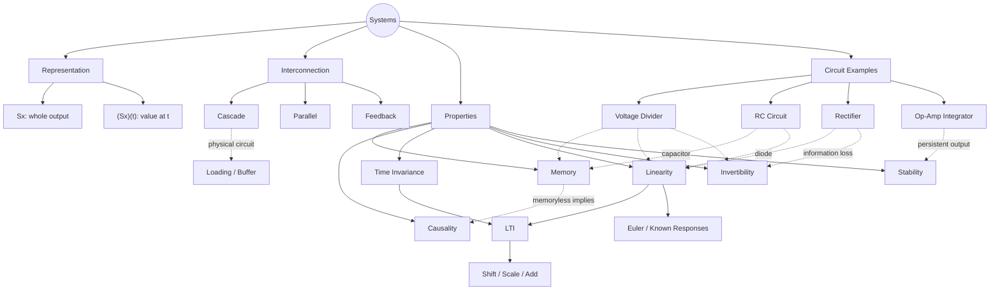
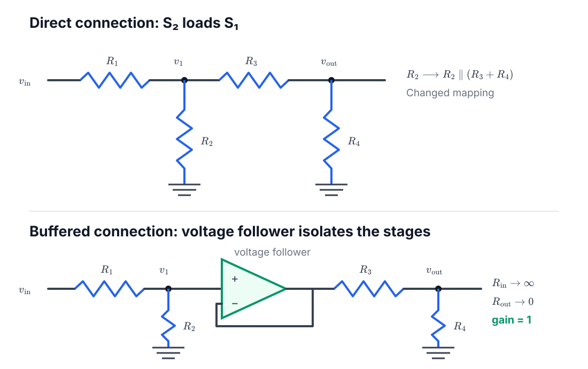
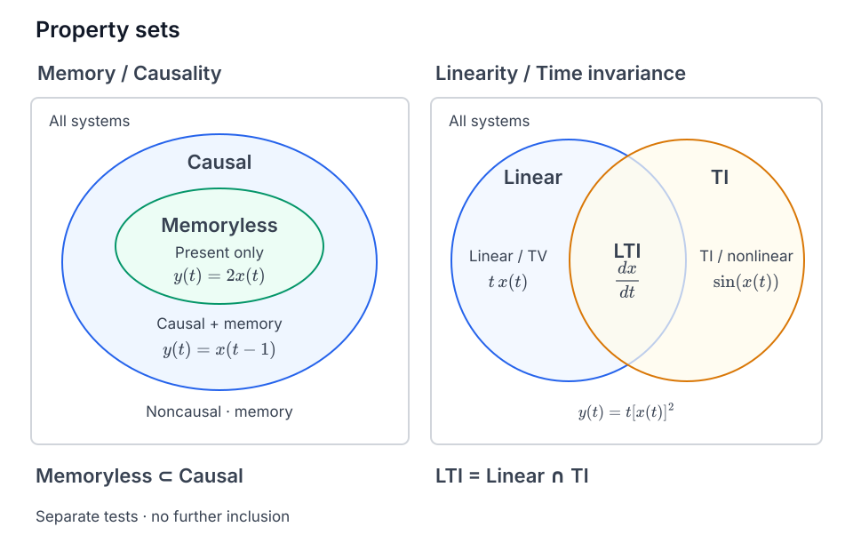
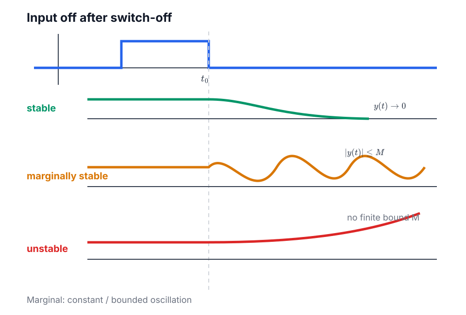
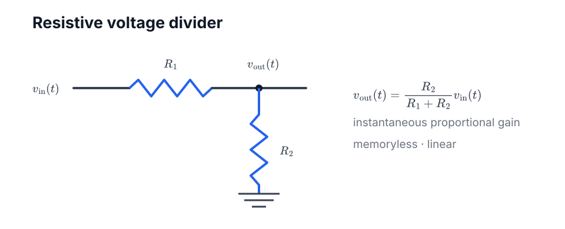
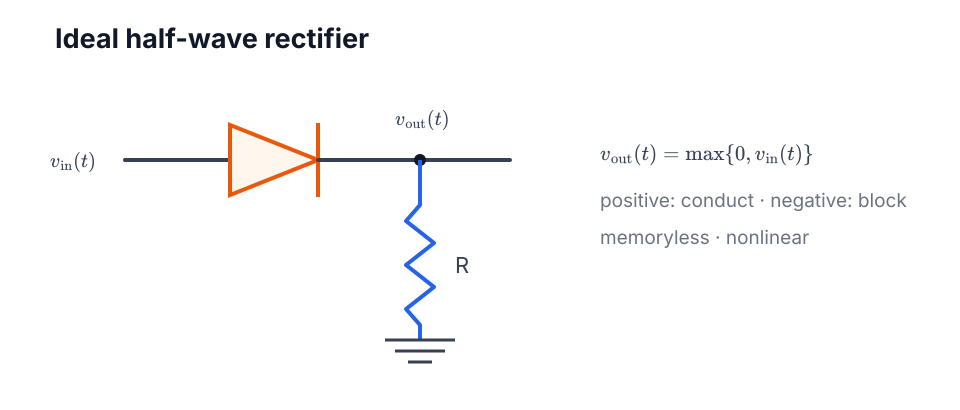
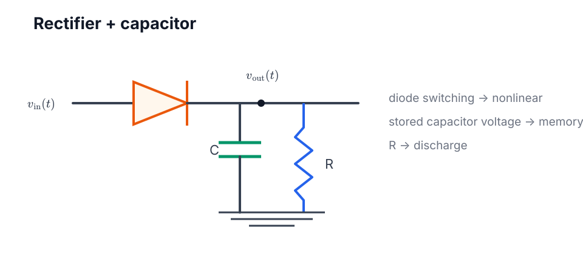
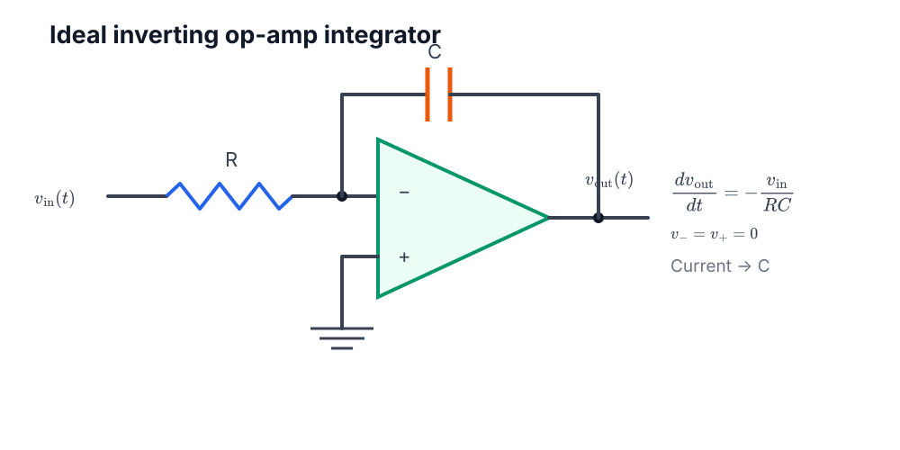

<!-- AI-assisted draft: Signals_and_System_02Oct.pdf, Chapter 3, pp. 45-53; SnS_Systems.pdf, slides 1-34; user discussion. -->

# Chapter 3 — Systems and Properties

Current scope: system properties · discussion through 3.5.6. Not a completion record.

---

## Map

Jump: [System](#system) · [Interconnection](#interconnection) · [Properties](#properties) · [Circuits](#circuits) · [Fast checks](#fast-checks)

---

## System

$$
S:\mathcal X\to\mathcal Y,
\qquad
x\mapsto y=Sx
$$

$$
y(t)=(Sx)(t)
$$

- $x,y$: whole signals
- $Sx$: whole output signal
- $(Sx)(t)$: output value at $t$
- parameters + initial conditions: fixed parts of $S$

Rule $\ne$ input $\ne$ known response pair. Multiple pairs: same $S$, different experiments.

$$
(Sx)(t)=t\,x(t-2)\quad\Rightarrow\quad (Sz)(t)=t\,z(t-2)
$$

Replace input only; keep clock / parameters / rule fixed.

$$
v(t)=t\,x(t-2)\quad\Rightarrow\quad v(t-1)=(t-1)x(t-3)
$$

Evaluating the whole signal at a new time replaces every time argument.

Basic systems:

$$
(Bx)(t)=x(-t)
\qquad\text{time reversal}
$$

$$
(Ix)(t)=\int_{-\infty}^{t}x(\tau)\,d\tau
\qquad\text{integration}
$$

$$
(Dx)(t)=\frac{dx}{dt}(t)
\qquad\text{differentiation}
$$

$$
(P_kx)(t)=kx(t)
\qquad\text{gain}
$$

---

## Interconnection

**Cascade**

$$
v=S_1x,
\qquad
y=S_2v
$$

$$
\boxed{S_{\mathrm{c}}=S_2\circ S_1}
$$

Right first. Composition; not multiplication.

**Parallel**

$$
\boxed{S_{\mathrm{p}}=S_1+S_2}
$$

$$
((S_1+S_2)x)(t)
=(S_1x)(t)+(S_2x)(t)
$$

**Feedback**

$$
e=x+\sigma S_2y,
\qquad
y=S_1e,
\qquad
\sigma\in\{-1,+1\}
$$

$$
y=S_1(x+\sigma S_2y)
$$

Well posed:

$$
\forall x,\ \exists!\,y
$$

One input → one unique output.

**Physical cascade: loading**

Isolated divider:

$$
v_1=\frac{R_2}{R_1+R_2}v_{\mathrm{in}}
$$

Second divider attached:

$$
R_2\longrightarrow R_2\parallel(R_3+R_4)
$$

$$
v_1=
\frac{R_2\parallel(R_3+R_4)}
{R_1+R_2\parallel(R_3+R_4)}v_{\mathrm{in}}
$$

Second stage changes first → block mappings not preserved.

Voltage follower:

$$
R_{\mathrm{in}}\to\infty,
\qquad
R_{\mathrm{out}}\to0,
\qquad
\text{gain}=1
$$

Isolation → valid cascade.

---

## Properties

**One workflow**

Read rule + domain → choose probe(s) → apply unchanged $S$ → compare → state evidence.

Prove: all admissible inputs. Disprove: one explicit counterexample.
Known pairs / graphs: contradiction → impossible; otherwise **could be**, not proven.

Four separate questions: **present? future? shift? superposition?**

Two panels, independent tests; no additional inclusion implied.

**Memory**

**Ask:** current input value alone enough?

**Test:** for every admissible $x_1,x_2,t$,

$$
x_1(t)=x_2(t)
\Rightarrow
(Sx_1)(t)=(Sx_2)(t)
$$

Pointwise form:

$$
(Sx)(t)=f(t,x(t))
$$

Time-independent case:

$$
(Sx)(t)=f(x(t))
$$

**Disprove:** same input value at $t_0$, unequal outputs at $t_0$.

**Trap:** using current input somewhere $\ne$ using current input only.
Past **or future** counts as memory; fixed rule / waveform shape does not decide it.

Gain:

$$
(P_kx)(t)=kx(t)
$$

Saturation:

$$
\mathrm{sat}_L(x)=
\begin{cases}
-L,&x<-L\\
x,&-L\le x\le L\\
L,&x>L
\end{cases}
$$

Has memory: depends on $x(\tau)$ for some $\tau\ne t$.

$$
x(t-1):\text{ past memory}
\qquad
x(t+1):\text{ future memory}
$$

Backward system:

$$
(Bx)(t)=x(-t)
$$

- $t<0$: reads future $-t>t$
- $t>0$: reads past $-t<t$
- overall: has memory

Memoryless: present only. Memory: past **or future**.

Practice: [nine systems](./chapter-3-representative-problems.md#p8-system-properties)

**Causality**

**Ask:** entire input history up to now enough?

**Test:** for every admissible $x_1,x_2,t_0$,

$$
x_1(\tau)=x_2(\tau)\quad\forall\tau\le t_0
\quad\Rightarrow\quad
(Sx_1)(t_0)=(Sx_2)(t_0)
$$

Past + present allowed; future forbidden.

**Disprove:** identical histories for $\tau\le t_0$, unequal outputs at $t_0$.

**Trap:** equal inputs at one instant is insufficient; that is the memoryless test.
Output onset alone is not a general test (offsets / fixed initial conditions).

$$
\text{memoryless}\Rightarrow\text{causal},
\qquad
\text{noncausal}\Rightarrow\text{has memory}
$$

For unrestricted inputs $y(t)=x(g(t))$: require $g(t)\le t$ for **every** $t$ in the domain.

$$
t=-3:\quad x(t/3)=x(-1),\quad -1>-3
\quad\Rightarrow\quad\text{noncausal}
$$

**Check negative times.** Negative time $\ne$ future; compare read time with present time.

Differentiator, differentiable inputs:

$$
x'(t)=\lim_{h\to0^+}\frac{x(t)-x(t-h)}h
$$

Past-side limit → causal; current value alone does not determine slope → memory.

Nearby values $\ne$ necessarily future. Causal $\ne$ perfectly physically realisable.

Practice: [S8 / S9](./chapter-3-representative-problems.md#p8-system-properties) · [graph tests](./chapter-3-representative-problems.md#p13-graph-tests)

**Time Invariance**

**Ask:** delayed experiment → same output, equally delayed?

**Test:** let $z(t)=x(t-d)$, $y=Sx$; compute separately:

$$
A(t)=(Sz)(t),\qquad B(t)=y(t-d)
$$

$$
\boxed{(Sz)(t)=(Sx)(t-d)\quad\forall x,t,d}
$$

Shift input → keep system rule fixed. Compare with whole output shifted.

**Disprove:** choose $x,d,t_0$ with $A(t_0)\ne B(t_0)$.

**Trap:** one passing signal does not prove TI. System delay $\ne$ test delay.
Changing output $\ne$ changing system; explicit $t$ alone is not a proof.

- Different read times: try $x(t)=t$; different gains: try $x(t)=1$.
- Gate: compare conditions **and** branch formulas.
- Input-controlled gate alone does not guarantee TI.
- Branch condition: rule selection; not domain / range / codomain.

$$
y(t)=x(2t):\quad
(Sz)(t)=x(2t-d),\qquad y(t-d)=x(2t-2d)
$$

Input shift $d$ → output shift $d/2$; TV. Constant input hides the difference.

Chain rule, differentiator:

$$
\frac{d}{dt}x(t-d)
=x'(t-d)\underbrace{\frac{d}{dt}(t-d)}_{1}
=y(t-d)
$$

$$
\frac{d}{dt}x(at+b)=a\,x'(at+b)
$$

Delay $\ne$ TV; future access $\ne$ TV; TI $\ne$ linearity.

Practice: [S6 / S7](./chapter-3-representative-problems.md#p8-system-properties) · [two-path tests](./chapter-3-representative-problems.md#p9-linear-ti)

**Linearity**

**Ask:** combine inputs → same combination of outputs?

**Test:** $z=\alpha x_1+\beta x_2$; compare $Sz$ with $\alpha Sx_1+\beta Sx_2$.

$$
\boxed{
S(\alpha x_1+\beta x_2)
=\alpha Sx_1+\beta Sx_2
}
$$

Equivalent:

$$
S(x_1+x_2)=Sx_1+Sx_2,
\qquad
S(\alpha x)=\alpha Sx
$$

**Disprove:** one failed scaling / addition test; choose inputs with relevant nonzero response.

$$
S0\ne0\Rightarrow\text{nonlinear};
\qquad S0=0\text{ alone does not prove linearity}
$$

**Trap:** fixed time-dependent coefficient allowed; input-dependent gain / switching requires testing.
Straight-line graph, memorylessness and TI are not linearity tests.

$$
y(t)=c(t)x(t):\quad\text{linear even when }c(t)\text{ varies}
$$

$$
y(t)=x(t-1)x(t-2):\quad S(kx)=k^2Sx\ne kSx
$$

Linearity: input combinations, not straight-line graphs.

Practice: [linear / TI independently](./chapter-3-representative-problems.md#p9-linear-ti)

Fixed zero initial condition required for RC superposition.

$$
RC\frac{dv_{\mathrm{out}}}{dt}+v_{\mathrm{out}}=v_{\mathrm{in}}
$$

Memory $\ne$ nonlinearity:

- divider: linear · memoryless
- RC: linear · memory
- ideal rectifier: nonlinear · memoryless
- rectifier + capacitor: nonlinear · memory

**Euler → Known Responses**

$$
e^{\pm j\theta}=\cos\theta\pm j\sin\theta
$$

$$
\boxed{\cos\theta=\frac{e^{j\theta}+e^{-j\theta}}2},
\qquad
\boxed{\sin\theta=\frac{e^{j\theta}-e^{-j\theta}}{2j}}
$$

Add → cos; subtract → sin. **Sin denominator: $2j$.**

Same system, multiple experiments:

$$
Sx_1=y_1,\quad Sx_2=y_2
\quad\Rightarrow\quad S(ax_1+bx_2)=ay_1+by_2
$$

Split input → retain coefficients → replace responses → recombine.

$$
e^{j(\omega t+\phi)}=e^{j\phi}e^{j\omega t}
$$

Phase factor: constant. Complex coefficients use complex-linearity (3.5.4).

Practice: [Euler / phase](./chapter-3-representative-problems.md#p11-euler-responses)

**LTI → Building Blocks**

$$
Sx=y
\quad\Rightarrow\quad
S\!\left[\sum_k a_kx(t-d_k)\right]=\sum_k a_ky(t-d_k)
$$

TI → horizontal shift. Linear → amplitude scale / sign / addition.

**Not guaranteed:** time compression / stretching / reversal.

Practice: [rectangle → triangle](./chapter-3-representative-problems.md#p12-lti-pulses)

**Invertibility**

$$
S^{-1}:S(\mathcal X)\to\mathcal X
$$

$$
\boxed{
S^{-1}S=SS^{-1}=P_1
}
$$

$S^{-1}S=P_1$ on $\mathcal X$ · $SS^{-1}=P_1$ on $S(\mathcal X)$.

$$
S^{-1}(Sx)=x,
\qquad
S(S^{-1}y)=y
$$

$$
(P_1x)(t)=x(t)
$$

Method: solve $y=Sx$ for $x$ → unique recovery? → verify both compositions.

$$
y(t)=x(t-d)\quad\Rightarrow\quad x(t)=y(t+d)
$$

$d>0$: inverse reads future → noncausal; no arbitrary-input real-time inverse.
Offline processing differs; causality alone does not guarantee ideal implementation.

Practice: [cascade / inverse](./chapter-3-representative-problems.md#p10-cascade-inverse)

Recovery requires one-to-one mapping:

$$
x_1\ne x_2
\quad\text{but}\quad
Sx_1=Sx_2
\Rightarrow
\text{not invertible}
$$

Gain:

$$
P_k^{-1}=P_{1/k},
\qquad k\ne0
$$

$$
P_0x=0\quad\forall x
\Rightarrow
\text{information lost}
$$

Half-wave rectifier:

$$
(Sx)(t)=\max\{0,x(t)\}
$$

All negative values $\mapsto0$ → not invertible.

Integrator / differentiator:

$$
DI=P_1
$$

$$
IDx=x-x(-\infty)
$$

$ID=P_1$ only with fixed $x(-\infty)=0$.

Practice: [information loss](./chapter-3-representative-problems.md#p1-invertibility) · [integration / differentiation](./chapter-3-representative-problems.md#p2-integration-differentiation)

**Finite-energy input-output stability**

$$
E_x=\int_{-\infty}^{\infty}|x(t)|^2dt
$$

$$
\boxed{
E_x<\infty
\Rightarrow
E_{Sx}<\infty
}
$$

Not required: $E_{Sx}<E_x$ · $y(t)\to$ constant · bounded amplitude alone.

Backward system:

$$
\begin{aligned}
E_{Bx}
&=\int_{-\infty}^{\infty}|x(-t)|^2dt\\
&=\int_{-\infty}^{\infty}|x(\tau)|^2d\tau\\
&=E_x
\end{aligned}
$$

Time reversal preserves area; not amplitude negation.

Rectifier:

$$
|Sx(t)|^2\le|x(t)|^2
\Rightarrow
E_{Sx}\le E_x
$$

**After switch-off**

Truncated input:

$$
\exists t_0:\quad x(t)=0,
\qquad \forall t>t_0
$$

$$
\begin{aligned}
y(t)\to0
&\quad\text{stable}\\
y(t)\not\to0,\ |y(t)|\le M\text{ eventually}
&\quad\text{marginally stable}\\
|y(t)|\text{ unbounded}
&\quad\text{unstable}
\end{aligned}
$$

Marginal: constant or bounded oscillation; convergence not required.

Two definitions: different tests; not equivalent in general.

Practice: [backward energy](./chapter-3-representative-problems.md#p3-backward-energy) · [marginal integrator](./chapter-3-representative-problems.md#p4-marginal-integrator) · [unstable modified integrator](./chapter-3-representative-problems.md#p5-modified-integrator)

---

## Circuit Links

**Voltage divider**

$$
v_{\mathrm{out}}(t)
=\frac{R_2}{R_1+R_2}v_{\mathrm{in}}(t)
$$

Gain $k=R_2/(R_1+R_2)$ · memoryless · linear · invertible if $k\ne0$ · finite-energy stable.

**RC circuit**

$$
E_C(t)=\frac12Cv_{\mathrm{out}}^2(t)
$$

Stored voltage → past information → memory.

Unit step, initially discharged:

$$
v_{\mathrm{out}}(t)=1-e^{-t/(RC)},
\qquad
\tau=RC
$$

$$
v_{\mathrm{out}}(\tau)=1-e^{-1}\approx0.632
$$

Pulse removed → exponential decay to $0$.

**Ideal half-wave rectifier**

$$
v_{\mathrm{out}}(t)=\max\{0,v_{\mathrm{in}}(t)\}
$$

Diode conducts for positive input · blocks negative input.

Memoryless · nonlinear · noninvertible · finite-energy stable.

**Rectifier + capacitor**

Diode switching → nonlinear · capacitor voltage → memory.

**Ideal op-amp integrator**

$$
v_-=v_+=0,
\qquad
i_-=0
$$

$$
\frac{v_{\mathrm{in}}(t)}{R}
=-C\frac{dv_{\mathrm{out}}}{dt}
$$

$$
\boxed{
v_{\mathrm{out}}(t)
=-\frac1{RC}\int_{-\infty}^{t}v_{\mathrm{in}}(\tau)d\tau
}
$$

Pulse:

$$
v_{\mathrm{in}}(t)=1\,\mathrm{V}
\quad(0\le t<RC),
\qquad
v_{\mathrm{in}}(t)=0
\quad\text{otherwise}
$$

$$
E_{\mathrm{in}}=(1\,\mathrm{V})^2RC<\infty
$$

After $RC$:

$$
v_{\mathrm{out}}(t)=-1\,\mathrm{V}
\Rightarrow
E_{\mathrm{out}}=\infty
$$

Finite-energy unstable · truncated-input marginally stable.

Practice: [op-amp integrator](./chapter-3-representative-problems.md#p6-op-amp-integrator)

---

## Fast Checks

- $S_2S_1$: $S_1$ first
- block cascade $\ne$ automatic physical cascade
- capacitor / inductor → likely memory
- diode switching → likely nonlinear
- information loss → not invertible
- $k=0$: many inputs → zero
- $D(Ix)=x$; $I(Dx)=x-$ initial value
- finite energy $\ne$ bounded amplitude
- truncated: input permanently off after $t_0$
- marginal: bounded; not necessarily constant
- one counterexample defeats “for every input” stability
- causality: entire domain, including negative $t$
- $\sin(x(t))$: value operation; $x(\sin t)$: time selection
- TI: shift input vs shift output; keep system rule fixed
- graph evidence: contradiction → impossible; compatibility $\ne$ proven

<!-- AI-assisted additions: causality, TI, Euler/LTI methods and practice links; full notes Ch. 3 pp. 50–60; SnS_09Oct.pdf slides 35–51; user discussion through 3.5.6. -->

<!-- AI-assisted revision: unified four-property reasoning and diagram, based on recurring substitution / quantifier / evidence confusions; not a mastery assessment. -->

[Representative problems](./chapter-3-representative-problems.md)
