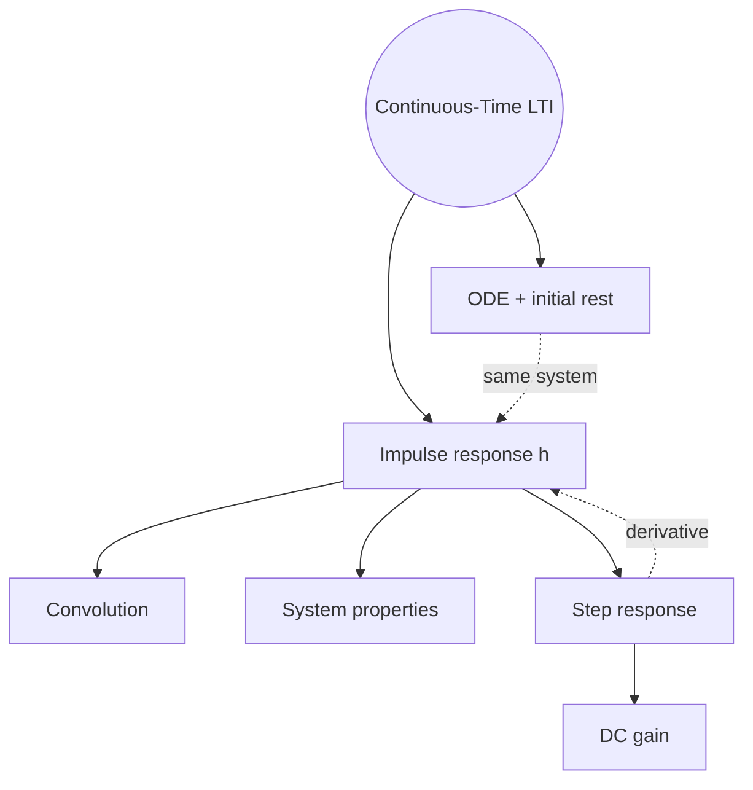
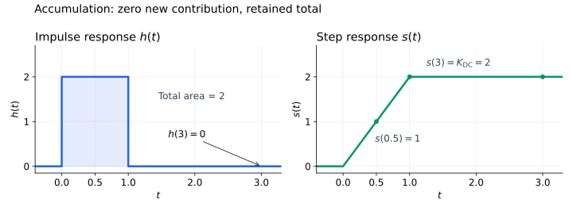
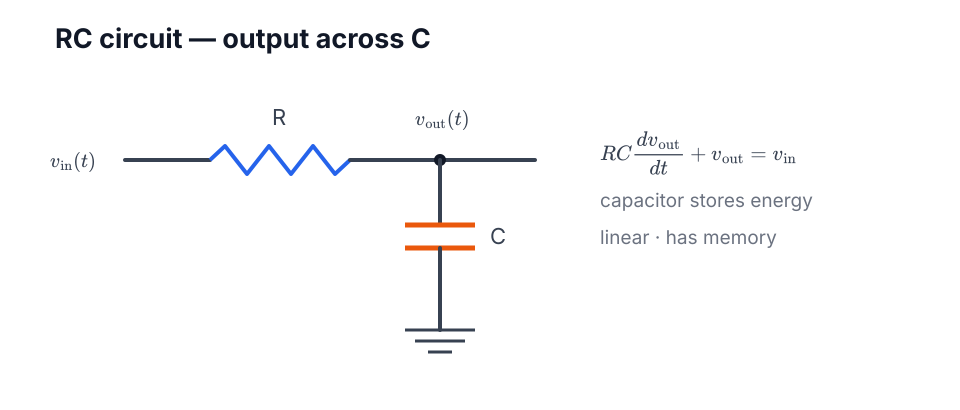
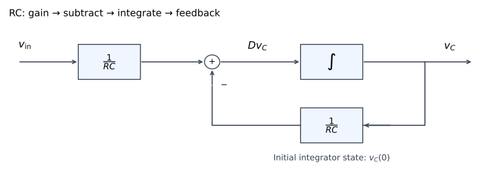

<!-- AI-assisted revision layout: full lecture notes §§6.1–6.5, pp99–108; lecture slides and reading questions. Core follows lecture topics; expanded reasoning folded. No exercise-completion claim. -->

# Chapter 6 — LTI and Convolution

Lecture notes · §§6.1–6.5

<a id="map"></a>



[Convolution](#convolution) · [LTI](#lti) · [Properties](#properties) · [Responses](#responses) · [ODE](#ode)

---

<a id="convolution"></a>

## Convolution

```math
\large
\boxed{(x*h)(t)=\int_{-\infty}^{\infty}x(\tau)h(t-\tau)\,d\tau}
```

**$t$**: output time · **$\tau$**: integration variable · **$t-\tau$**: lag

Fix $t$ → integrate all $\tau$ → **one value** · vary $t$ → **whole signal**

```math
h(\tau)\ \xrightarrow{\text{reverse}}\ h(-\tau)
\ \xrightarrow{\text{shift}}\ h(t-\tau)
```

Multiply by $x(\tau)$ → **signed area** · not $x(t)h(t)$

<details>
<summary>t / τ · reversal · integration limits</summary>

$\displaystyle t=5:\quad y(5)=\int_{-\infty}^{\infty}x(\tau)h(5-\tau)\thinspace d\tau.$

Input at $\tau=2$ → lag $5-2=3$ · $\tau$: integrated away

Fixed $t$, increasing $\tau$ → decreasing $t-\tau$ → reversal

No imposed $t>0$ / $y(t)>0$ · overlap ≠ positive result

**Support intersection**

$\displaystyle x(\tau)\ne0:\ a\le\tau\le b,\qquad h(v)\ne0:\ c\le v\le d.$

$\displaystyle c\le t-\tau\le d\iff t-d\le\tau\le t-c.$

$\displaystyle L(t)=\max(a,t-d),\qquad U(t)=\min(b,t-c).$

$L<U$: integrate product · $L>U$: zero · ordinary $L=U$: zero area

Changing active bounds → piecewise $t$-intervals · impulses: sifting, not overlap length

Unit rectangles only: integral = overlap length

</details>

↔ [Ch2 transforms](./chapter-2-signals-and-properties.md#time-transform) · [moving-window method](./chapter-6-representative-problems.md#window)

---

<a id="lti"></a>

## LTI Representation

```math
\large
\boxed{\delta\xrightarrow{S}h}
\qquad
\boxed{y=Sx=x*h}
```

**$S$**: system · **$h$**: fixed impulse response · **$x,y$**: input / output

```math
S\longleftrightarrow h
```

**Same $h$ → same LTI system** · not inverse input recovery

<a id="decomposition"></a>

<details>
<summary>Why convolution? · linearity + TI</summary>

$\displaystyle \delta(t-a)\xrightarrow{S}h(t-a)\qquad(\mathrm{TI}).$

$\displaystyle \sum_i c_i\delta(t-a_i)\xrightarrow{S}\sum_i c_i h(t-a_i)\qquad(\mathrm{linear}).$

[Delta sifting](./chapter-2-signals-and-properties.md#impulse):

$\displaystyle x(t)=\int x(\tau)\delta(t-\tau)\thinspace d\tau.$

Weighted shifted impulses → weighted shifted responses:

$\displaystyle y(t)=\int x(\tau)h(t-\tau)\thinspace d\tau.$

**Lecture approximation**

$\displaystyle \Delta=\frac{1}{n},\quad \delta_n(t)=n\ \ (|t|<\frac{1}{2n});\quad0\text{ otherwise}.$

Height $n$ · width $\Delta$ · unit area

$\displaystyle x(t)\approx\sum_i x(i\Delta)\Delta\delta_n(t-i\Delta).$

$\displaystyle h_n=S\delta_n,\quad y(t)\approx\sum_i x(i\Delta)\Delta h_n(t-i\Delta).$

$\Delta\to0$: convolution integral · suitable convergence assumptions

Context: reverb / matched filters / CNN · frequency-domain analysis later

</details>

<a id="integrator"></a>

**Integrator**

```math
h=u
\quad\Rightarrow\quad
y(t)=\int_{-\infty}^{t}x(\tau)\,d\tau
```

$u(t-\tau)=1\iff\tau\le t$ · **future contributions zero**

<details>
<summary>Integral cutoff</summary>

$\displaystyle y(t)=\int_{-\infty}^{t}x(\tau)\cdot1\thinspace d\tau+\int_t^\infty x(\tau)\cdot0\thinspace d\tau=\int_{-\infty}^{t}x(\tau)\thinspace d\tau.$

$h=u$: impulse response · not chosen input

</details>

↔ [Ch3 LTI](./chapter-3-systems-and-properties.md#lti-building-blocks) · [step response](#step)

---

<a id="properties"></a>
<a id="convolution-algebra"></a>
<a id="inheritance"></a>

## Properties

**Convolution ↔ LTI interconnections**

```math
\begin{aligned}
h_{\mathrm{cascade}}&=h_1*h_2,\\
h_{\mathrm{parallel}}&=h_1+h_2.
\end{aligned}
```

```math
x*h=h*x,\qquad (x*h)*g=x*(h*g)
```

**Commutative**: reorder · **associative**: regroup

```math
x*(h+g)=x*h+x*g,\qquad
a(x*h)=(ax)*h=x*(ah)
```

**Distribute** over addition · gain **once**

```math
D(x*h)=(Dx)*h=x*(Dh)
```

```math
I(x*h)=(Ix)*h=x*(Ih)
```

Differentiate / integrate **one factor** · not product rule

$D$: derivative · $I$: integral from $-\infty$ · well-defined compositions

↔ [derivative proof](./chapter-6-representative-problems.md#window) · [Ch3 connections](./chapter-3-systems-and-properties.md#interconnection)

<a id="inverse"></a>

**Identity / inverse**

```math
x*\delta=x,\qquad h=k\delta\Rightarrow y=kx
```

```math
\boxed{h*h_{\mathrm{inv}}=\delta}
\iff SS^{-1}=S^{-1}S=P_1
```

Inverse ≠ $\frac{1}{h(t)}$ · existence / causality / stability: **not guaranteed**

```math
\delta(t-a)*\delta(t-b)=\delta\bigl(t-(a+b)\bigr)
```

Delay $a$ + advance $a$ → identity · mathematical inverse ≠ real-time feasibility

↔ [delay / inverse method](./chapter-6-representative-problems.md#delay)

<a id="h-tests"></a>

**Memoryless**

```math
\large
\boxed{h=k\delta}\quad\Longleftrightarrow\quad y=kx
```

**Zero lag only** · impulse weight $k$ · constant gain ≠ constant $h$

**Causal**

```math
\large
\boxed{h(t)=0\quad(t<0)}
```

Negative lag $\tau<0$ → $x(t-\tau)$: **future input**

**Stable — BIBO**

```math
\large
\boxed{\int_{-\infty}^{\infty}|h(\tau)|\,d\tau<\infty}
```

Ordinary $h$ · weighted impulses: **sum absolute weights**

<details>
<summary>Why these tests? · energy stability</summary>

$\displaystyle y(t)=\int h(\tau)x(t-\tau)\thinspace d\tau.$

Memoryless: only $x(t)$ → $h=k\delta$ · no delayed / advanced samples

Causal: $\tau<0\Rightarrow t-\tau>t$ → eliminate negative-lag response

**Bounded input**

$\displaystyle |x(t)|\le M\Rightarrow |y(t)|\le M\int|h(\tau)|\thinspace d\tau.$

$\displaystyle \|h\|_1=\int|h(\tau)|\thinspace d\tau<\infty.$

**Finite-energy input**

$\displaystyle E_x<\infty\Rightarrow E_y\le\|h\|_1^{2}E_x<\infty.$

Absolute integrability → sufficient for Ch3 energy stability · not identical definitions

Stable ≠ finite-energy output for every input

Integrator $h=u$: bounded input $u$ → unbounded ramp $tu(t)$ → unstable

</details>

↔ [Ch3 stability](./chapter-3-systems-and-properties.md#stability)

---

<a id="responses"></a>
<a id="step"></a>

## Step Response & DC Gain

```math
\delta\xrightarrow{S}h
\qquad
u\xrightarrow{S}s
```

**$S$**: system · **$s$**: step response · name from **input**, not output shape

```math
\large
\boxed{s(t)=\int_{-\infty}^{t}h(\tau)\,d\tau}
\qquad
\boxed{h=s'}
```

**$h$**: contribution rate · **$s$**: accumulated area

$h=0$ → **constant $s$**, not necessarily zero



<details>
<summary>Why s = ∫h? · derivative relation</summary>

$\displaystyle s=u\ast h=h\ast u=\int h(\tau)u(t-\tau)\thinspace d\tau.$

$u(t-\tau)=1$ for $\tau\le t$, zero otherwise:

$\displaystyle s(t)=\int_{-\infty}^{t}h(\tau)\thinspace d\tau.$

**Convolution calculus**

$\displaystyle s'=D(u\ast h)=(Du)\ast h=\delta\ast h=h.$

$\displaystyle I(\delta\ast h)=(I\delta)\ast h=u\ast h=s\Rightarrow Ih=s.$

Input $u\to\delta$ · output $s\to h$ · same $S$

Jumps in $s$ → impulses in $h$ · not $s'\to u$

</details>

↔ [integrator cutoff](#integrator) · [accumulation method](./chapter-6-representative-problems.md#accumulation)

<a id="dc-gain"></a>

**DC gain — stable LTI**

```math
\large
\boxed{K_{\mathrm{DC}}=\lim_{t\to\infty}s(t)
=\int_{-\infty}^{\infty}h(\tau)\,d\tau}
```

**Final height**, not $\int s$ · signed area · **one scalar**

```math
x=Au\quad\Rightarrow\quad\lim_{t\to\infty}y(t)=AK_{\mathrm{DC}}
```

Same gain ≠ same system · no finite limit → no finite step-defined gain

```math
\underbrace{\int |h|}_{\mathrm{stability}}
\qquad
\underbrace{\int h}_{\mathrm{DC\ gain}}
\qquad
\underbrace{\int |x|^{2}}_{\mathrm{energy}}
```

<details>
<summary>Example · one echo</summary>

$\displaystyle y(t)=x(t)+\frac{1}{2}x(t-2).$

$\displaystyle h(t)=\delta(t)+\frac{1}{2}\delta(t-2).$

$\displaystyle s(t)=u(t)+\frac{1}{2}u(t-2),\qquad K_{\mathrm{DC}}=\frac{3}{2}.$

Step input: output $1$ → $\frac{3}{2}$ after echo · not a ramp

Lag $2$: memory · no negative lag: causal · $|y|\le\frac{3}{2}M$: stable

</details>

---

<a id="ode"></a>

## ODE Representation



```math
\frac{v_{\mathrm{in}}-v_C}{R}=C\frac{dv_C}{dt}
```

```math
\large
\boxed{Dv_C+\frac{1}{RC}v_C=\frac{1}{RC}v_{\mathrm{in}}}
```

**ODE**: evolution law · **initial state**: unique trajectory

<a id="ode-lti"></a>

**Linear constant coefficients + initial rest → LTI**

```math
\mathrm{ODE}\longleftrightarrow h\longleftrightarrow y=x*h
```

Same mapping · different representations · Laplace → $h$ later

<details>
<summary>Initial state · linearity / TI proof</summary>

$\displaystyle v_{\mathrm{in}}=0\Rightarrow v_C(t)=Ae^{-t/(RC)}.$

Unknown $A$ → initial voltage · capacitor state: past history

Input zero before $0$, $v_C(0)=V_0$:

$\displaystyle v_C(t)=V_0e^{-t/(RC)}+(v_{\mathrm{in}}\ast h)(t),\quad t\ge0.$

$V_0\ne0$: zero input ≠ zero output · initial rest: convolution alone

Switch at $0$: post-switch ODE need not model earlier circuit

**General first-order example**

$\displaystyle y'+ay=bx.$

$\displaystyle (\alpha y_1+\beta y_2)'+a(\alpha y_1+\beta y_2)=b(\alpha x_1+\beta x_2).$

$\displaystyle \frac{d}{dt}y(t-d)+ay(t-d)=bx(t-d).$

Superposition + compatible shifted conditions → LTI

Causality alone ≠ specified voltage · fixed-start conditions ≠ automatic whole-axis TI

</details>

**Integrator feedback**

```math
Dv_C=\frac{1}{RC}v_{\mathrm{in}}-\frac{1}{RC}v_C
```



Gain → subtraction → integration · initial charge → integrator state

↔ [state / feedback method](./chapter-6-representative-problems.md#rc) · [Ch3 feedback](./chapter-3-systems-and-properties.md#interconnection)

---

[Representative methods](./chapter-6-representative-problems.md) · [Ch2](./chapter-2-signals-and-properties.md) · [Ch3](./chapter-3-systems-and-properties.md)
