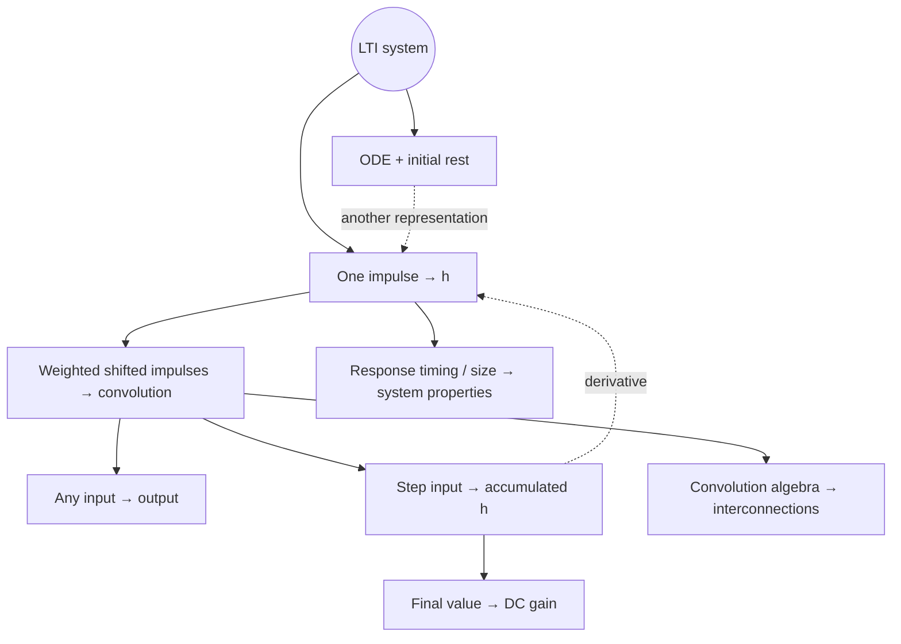

<!-- AI-assisted teaching-chain rewrite: Signals_and_System_02Oct.pdf §§6.1–6.5, pp99–108; Chapter6 slides; reading discussions and “解释第一题 integrals”. Added generic echo example and explicit conceptual bridges. No exercise-completion claim. -->

# Chapter 6 — Continuous-Time LTI

<a id="map"></a>



[Impulse response](#lti) · [Convolution](#convolution) · [Step / DC](#responses) · [Properties](#properties) · [ODE](#ode)

Prerequisites: [linearity / TI](./chapter-3-systems-and-properties.md#properties) · [delta / step](./chapter-2-signals-and-properties.md#elementary-signals) · [integration](./chapter-2-signals-and-properties.md#operations)

---

<a id="lti"></a>

## Impulse Response → Whole System

**From Chapter 3: a rule $S$, not a signal**

```math
x\xrightarrow{S}y,\qquad y=Sx,\qquad y(t)=(Sx)(t)
```

$x,y$: whole signals · $x(t),y(t)$: values · $S$: input-to-output rule

**LTI: two permissions**

```math
S(ax_1+bx_2)=aSx_1+bSx_2
```

```math
x_a(t)=x(t-a)\quad\Rightarrow\quad(Sx_a)(t)=y(t-a)
```

Linear → scale / add responses · TI → shift response by input’s shift

↔ [Ch3 LTI building blocks](./chapter-3-systems-and-properties.md#lti-building-blocks)

**One test input: unit impulse**

```math
\boxed{\delta\xrightarrow{S}h}
\qquad h=S\delta
```

$h$: impulse **response**, not the impulse itself · whole output waveform, not one number

Room example: short shot → direct sound + later echoes<br>
Same room / fixed LTI approximation → same $h$ · different recordings → different $y$

Applications: reverb · matched filters (radar / sonar / gravitational waves) · CNN sliding kernels<br>
Time-domain convolution → frequency-domain analysis

**Running example: direct sound + one echo**

```math
(Sx)(t)=x(t)+\frac{1}{2}x(t-2)
```

Input now + half-strength input from $2$ seconds ago:

```math
x=\delta
\quad\Rightarrow\quad
h(t)=\delta(t)+\frac{1}{2}\delta(t-2)
```

$h$: two response events · weights $1,\frac{1}{2}$ · delays $0,2$

<a id="decomposition"></a>

**Why one impulse response is enough**

Shift / scale the input impulse → same shift / scale of $h$:

```math
\delta(t-a)\xrightarrow{\mathrm{TI}}h(t-a),
\qquad
c\delta(t-a)\xrightarrow{\mathrm{linear}}ch(t-a)
```

Add input impulses → add their responses:

```math
c_1\delta(t-a_1)+c_2\delta(t-a_2)
\xrightarrow{S}
c_1h(t-a_1)+c_2h(t-a_2)
```

Continuous input: infinitely many weighted slices

```math
\boxed{
x(t)=\int_{-\infty}^{\infty}x(\tau)\delta(t-\tau)\,d\tau
}
```

[Delta sifting](./chapter-2-signals-and-properties.md#impulse) · slice at $\tau$: weight $x(\tau)d\tau$

```math
x(\tau)\delta(t-\tau)\,d\tau
\xrightarrow{S}
x(\tau)h(t-\tau)\,d\tau
```

Sum all slice responses:

```math
\boxed{
y(t)=\int_{-\infty}^{\infty}x(\tau)h(t-\tau)\,d\tau
=(x*h)(t)
}
```

Linearity → sum / weights · TI → $h(t-\tau)$ · suitable limiting assumptions

```math
\boxed{S\longleftrightarrow h}
```

Known $h$ → output for every admissible $x$ · same $h$ → same LTI mapping<br>
Not invertibility $x\leftrightarrow y$ · [inverse system](#inverse): separate question

<details>
<summary>Lecture construction: finite-width slices → integral</summary>

$\displaystyle \Delta=\frac{1}{n},\qquad \delta_n(t)=n\ \ (|t|<\frac{1}{2n});\quad0\text{ otherwise}.$

Unit area · $x(i\Delta)\Delta\delta_n(t-i\Delta)$: height $x(i\Delta)$, width $\Delta$

$\displaystyle x(t)\approx\sum_i x(i\Delta)\Delta\delta_n(t-i\Delta).$

$\displaystyle h_n=S\delta_n,\qquad y(t)\approx\sum_i x(i\Delta)\Delta h_n(t-i\Delta).$

$\displaystyle \Delta\to0:\quad y(t)=\int x(\tau)h(t-\tau)\thinspace d\tau.$

Approximation → superposition → shifted responses → limit<br>
Rigorous convergence proof: beyond present course tools

</details>

---

<a id="convolution"></a>

## Convolution: One Output Value at a Time

```math
\boxed{(x*h)(t)=\int_{-\infty}^{\infty}x(\tau)h(t-\tau)\,d\tau}
```

$\ast$: two signals → one signal · **not** pointwise product $x(t)h(t)$<br>
General operation on signals · LTI application: one factor $=$ system response $h$

**$t$ versus $\tau$**

$t$: output time under investigation · $\tau$: input time being summed

```math
\underbrace{x(\tau)}_{\text{input weight at }\tau}
\underbrace{h(t-\tau)}_{\text{response after lag }t-\tau}
\,d\tau
```

Example $t=5$, $\tau=2$: input at $2$ → response $3$ seconds later

```math
y(5)=\int_{-\infty}^{\infty}x(\tau)h(5-\tau)\,d\tau
```

Hold $t=5$ · sum contributions from **all $\tau$** → one number $y(5)$<br>
Repeat for every $t$ → curve $y(t)$ · $\tau$ disappears after integration

Any real $t$ · no imposed $t>0$ / $y(t)>0$

**Why reverse?**

Fixed $t$: horizontal axis $=\tau$ · argument of $h$ decreases as $\tau$ increases

```math
h(\tau)\longrightarrow h(-\tau)\longrightarrow h(t-\tau)
```

Reverse → shift by $t$ → multiply by $x(\tau)$ → integrate product<br>
Reversal: consequence of **elapsed time $t-\tau$**, not an extra physical operation

Product’s signed area → $y(t)$ · unit rectangles only → overlap length

↔ [Ch2 time transforms](./chapter-2-signals-and-properties.md#time-transform)

**Where to integrate? Both factors nonzero**

```math
x(\tau)\ne0:\ a\le\tau\le b,
\qquad h(v)\ne0:\ c\le v\le d
```

```math
c\le t-\tau\le d
\iff
t-d\le\tau\le t-c
```

```math
\boxed{L(t)=\max(a,t-d),\qquad U(t)=\min(b,t-c)}
```

$L<U$: integrate product $L\to U$ · $L>U$: zero<br>
Finite ordinary functions, $L=U$: zero-area contact · impulses: separate sifting rule

Changed active bounds → new $t$-interval → piecewise output<br>
Overlap ≠ positive result: negative values / cancellation possible

[Moving-window calculation + full derivative proof](./chapter-6-representative-problems.md#window)

**Impulse shortcut: weighted copies, not overlap geometry**

```math
\delta_a(t)=\delta(t-a)
\quad\Rightarrow\quad
\boxed{(x*\delta_a)(t)=x(t-a)}
```

```math
h(t)=\delta(t)+\frac{1}{2}\delta(t-2)
\Rightarrow
y(t)=x(t)+\frac{1}{2}x(t-2)
```

Back to the echo rule · same system, two representations

<a id="integrator"></a>

**Step shortcut: accumulation**

```math
h=u
\quad\Rightarrow\quad
h(t-\tau)=u(t-\tau)=
\begin{cases}
1,&\tau\le t,\\
0,&\tau>t
\end{cases}
```

```math
y(t)=\int_{-\infty}^{t}x(\tau)\cdot1\,d\tau
+\int_t^\infty x(\tau)\cdot0\,d\tau
=\boxed{\int_{-\infty}^{t}x(\tau)\,d\tau}
```

$h=u$ → **integrator system** · $u$ response to impulse, not necessarily chosen input

---

<a id="responses"></a>
<a id="step"></a>

## Step Response → DC Gain

**Same system, different test input**

```math
\delta\xrightarrow{S}h
\qquad
u\xrightarrow{S}s
```

Capital $S$: system · lowercase $s$: step-response signal<br>
Response names: **input types**, not output shapes

**From convolution to accumulated $h$**

Use commutativity, $u\ast h=h\ast u$:

```math
s(t)=\int_{-\infty}^{\infty}h(\tau)u(t-\tau)\,d\tau
```

$u(t-\tau)=1$ for $\tau\le t$, zero otherwise → same cutoff as [integrator](#integrator)

```math
\boxed{s(t)=\int_{-\infty}^{t}h(\tau)\,d\tau}
\qquad
\boxed{h(t)=s'(t)}
```

$h(t)$: new contribution rate · $s(t)$: accumulated result<br>
$h=0$ on an interval → constant $s$, **not necessarily zero**


Rectangle $h$: $2$ on $[0,1)$ · accumulated $s$: $2t$ then $2$<br>
$h(3)=0$ · $s(3)=2$ · no new area, retained past total

[Values / final-value example](./chapter-6-representative-problems.md#accumulation)

**Echo example: not a ramp**

```math
h(t)=\delta(t)+\frac{1}{2}\delta(t-2)
\Rightarrow
s(t)=u(t)+\frac{1}{2}u(t-2)
```

Input fixed at $1$ after $0$ · output $1$ then $\frac{3}{2}$ after echo arrives<br>
Step response: ramp / jumps / oscillation / other shapes, depending on $h$

**Derivative relation: same $S$, differentiated input / output**

```math
s'=D(u*h)=(Du)*h=\delta*h=h
```

Input $u\to\delta$ · corresponding output $s\to h$<br>
Not $s'\to u$ · system $S$ unchanged · jumps in $s$ → impulses in $h$

Equivalent integral property:

```math
I(\delta*h)=(I\delta)*h=u*h=s
\Rightarrow Ih=s
```

↔ [convolution calculus](#convolution-algebra) · [Ch2 step / impulse](./chapter-2-signals-and-properties.md#elementary-signals)

<a id="dc-gain"></a>

**DC gain: sustained input → settled output**

Stable LTI · input $u$: eventually constant $1$

```math
s(t)=\int_{-\infty}^{t}h(\tau)\,d\tau
\quad\xrightarrow{t\to\infty}\quad
\boxed{K_{\mathrm{DC}}=\int_{-\infty}^{\infty}h(\tau)\,d\tau}
```

Accumulation window expands → all $h$ included → **final height of $s$**

```math
\boxed{K_{\mathrm{DC}}=\lim_{t\to\infty}s(t)}
\qquad
x=Au\Rightarrow\lim_{t\to\infty}y(t)=AK_{\mathrm{DC}}
```

Echo: $K_{\mathrm{DC}}=1+\frac{1}{2}=\frac{3}{2}$ · constant input $2$ → final output $3$

Whole $h$: transient + steady behaviour · $\int h$: **one scalar only**<br>
Same gain ≠ same system · final height $\ne\int s$ · no finite limit → no finite step-defined gain

---

<a id="properties"></a>
<a id="h-tests"></a>

## System Properties from $h$

Starting point: **response at lag $\tau$ weights input at $t-\tau$**

```math
y(t)=\int_{-\infty}^{\infty}h(\tau)x(t-\tau)\,d\tau
```

**Memoryless: only current input**

```math
y(t)=kx(t)\iff\boxed{h(t)=k\delta(t)}
```

Lag $0$ only · nonzero impulse weight allowed · constant gain ≠ constant $h$

Echo: $h$ also at lag $2$ → past input → **memory**

Not $h=0$ everywhere · impulse area $k$, not ordinary point value $h(0)$

**Causal: no future input**

```math
\tau<0\Rightarrow t-\tau>t
```

Negative lag → future sample; eliminate such weights:

```math
\boxed{h(\tau)=0\quad(\tau<0)}
```

Echo lags $0,2$ → causal · lag $-2$ → advance → noncausal<br>
Negative **lag**, not absolute negative input time · [Ch3 causality](./chapter-3-systems-and-properties.md#causality)

**Stable: bounded input → bounded output**

```math
|x(t)|\le M
\Rightarrow
|y(t)|\le\int|h(\tau)|\,|x(t-\tau)|\,d\tau
\le M\int|h(\tau)|\,d\tau
```

Ordinary $h$, BIBO criterion:

```math
\boxed{\|h\|_1=\int_{-\infty}^{\infty}|h(\tau)|\,d\tau<\infty}
```

Finite weighted impulses: sum absolute weights<br>
Echo: $|y(t)|\le\frac{3}{2}M$ → stable

Integrator $h=u$: $\int|h|=\infty$ · bounded input $u$ → unbounded ramp $tu(t)$

**Three integrals, three questions**

```math
\underbrace{\int|h|}_{\text{bounded amplification?}}
\qquad
\underbrace{\int h}_{\text{steady gain?}}
\qquad
\underbrace{\int|x|^{2}}_{\text{signal energy?}}
```

Absolute values: no cancellation · stability ≠ energy of $h$<br>
Stable system + infinite-energy input → possibly infinite-energy output

Finite-energy connection:

```math
\|h\|_1<\infty,\ E_x<\infty
\Rightarrow E_y\le\|h\|_1^{2}E_x<\infty
```

Sufficient for [Ch3 energy stability](./chapter-3-systems-and-properties.md#stability) · not identical definitions

<a id="convolution-algebra"></a>
<a id="inheritance"></a>

**Interconnections: convolution algebra inherited by LTI systems**

```math
S_2(S_1x)=(x*h_1)*h_2=x*(h_1*h_2)
```

Cascade response $h_1\ast h_2$ · parallel response $h_1+h_2$

```math
x*h=h*x,\qquad
(x*h)*g=x*(h*g)
```

Commutativity → reorder LTI cascade · associativity → regroup

```math
x*(h+g)=x*h+x*g,\qquad
a(x*h)=(ax)*h=x*(ah)
```

Distribute over parallel · move constant gain · scalar once, not twice<br>
General systems: no automatic commutativity · [Ch3 connections](./chapter-3-systems-and-properties.md#interconnection)

**Calculus: one factor at a time**

```math
D(x*h)=(Dx)*h=x*(Dh)
```

```math
I(x*h)=(Ix)*h=x*(Ih)
```

$D$: derivative · $I$: integral from $-\infty$<br>
Output derivative = convolve either differentiated factor · **not** $x'\ast h'$ / product-rule sum

Well-defined integrals / derivatives / compositions · impulses: distribution sense<br>
[Complete moving-window proof](./chapter-6-representative-problems.md#window) · [response relation](#step)

<a id="inverse"></a>

**Identity → inverse**

```math
x*\delta=x
\quad\Rightarrow\quad
h=\delta:\ S=P_1
```

Identity: output unchanged · gain $k$: $h=k\delta$

Undo $S$: cascade must act as identity

```math
\boxed{h*h_{\mathrm{inv}}=\delta}
\iff
SS^{-1}=S^{-1}S=P_1
```

Convolution inverse ≠ $\frac{1}{h(t)}$ · not always existent

```math
\delta(t-a)*\delta(t-b)=\delta\bigl(t-(a+b)\bigr)
```

Delays add · undo delay $a>0$: choose $b=-a$

```math
\delta(t-a)*\delta(t+a)=\delta(t)
```

Inverse needs future samples → noncausal · mathematical existence ≠ physical real-time feasibility

[Delay proof](./chapter-6-representative-problems.md#delay) · [Ch3 inverse](./chapter-3-systems-and-properties.md#invertibility)

---

<a id="ode"></a>

## ODE: Another Description of the Same Mapping

**RC: input voltage → capacitor voltage**


```math
\frac{v_{\mathrm{in}}-v_C}{R}=i=C\frac{dv_C}{dt}
```

```math
\boxed{Dv_C+\frac{1}{RC}v_C=\frac{1}{RC}v_{\mathrm{in}}}
\qquad D=\frac{d}{dt}
```

Circuit law → relation between input / output · not yet unique trajectory

```math
v_{\mathrm{in}}=0\Rightarrow v_C(t)=Ae^{-t/(RC)}
```

Unknown $A$ → initial voltage needed · capacitor state: stored past<br>
Switch at $0$: post-switch equation need not describe earlier circuit

<a id="ode-lti"></a>

**Why initial rest matters**

```math
v_C(t)=
\underbrace{V_0e^{-t/(RC)}}_{\text{initial-state response}}
+\underbrace{(v_{\mathrm{in}}*h)(t)}_{\text{zero-state response}}
\qquad(t\ge0)
```

Here: input zero before $0$ · $v_C(0)=V_0$<br>
$V_0\ne0$: zero input can produce nonzero output → not a linear input-only map<br>
Initial rest: $V_0=0$ → convolution alone

**Linear constant-coefficient ODE + compatible zero-state solution**

```math
y'+ay=bx
```

Linearity:

```math
(\alpha y_1+\beta y_2)'+a(\alpha y_1+\beta y_2)
=b(\alpha x_1+\beta x_2)
```

TI:

```math
\frac{d}{dt}y(t-d)+ay(t-d)=bx(t-d)
```

Same coefficients / compatible shifted conditions → same mapping after shift<br>
Causality alone ≠ specified initial voltage · fixed-start conditions ≠ automatic whole-axis TI

```math
\boxed{\text{ODE + zero-state convention}\longleftrightarrow h\longleftrightarrow y=x*h}
```

ODE: evolution law · $h$: impulse test result · convolution: arbitrary input output<br>
Laplace later → derive $h$ from ODE · no new class beyond LTI

**Block diagram: integrate the derivative**

```math
Dv_C=\frac{1}{RC}v_{\mathrm{in}}-\frac{1}{RC}v_C
```


Input gain − output feedback → $Dv_C$ → integrator → $v_C$<br>
Initial voltage: integrator state · ideal differentiation: practical limitations

[State / feedback example](./chapter-6-representative-problems.md#rc)

---

[Representative methods](./chapter-6-representative-problems.md) · [Ch2 signals](./chapter-2-signals-and-properties.md) · [Ch3 systems](./chapter-3-systems-and-properties.md)
