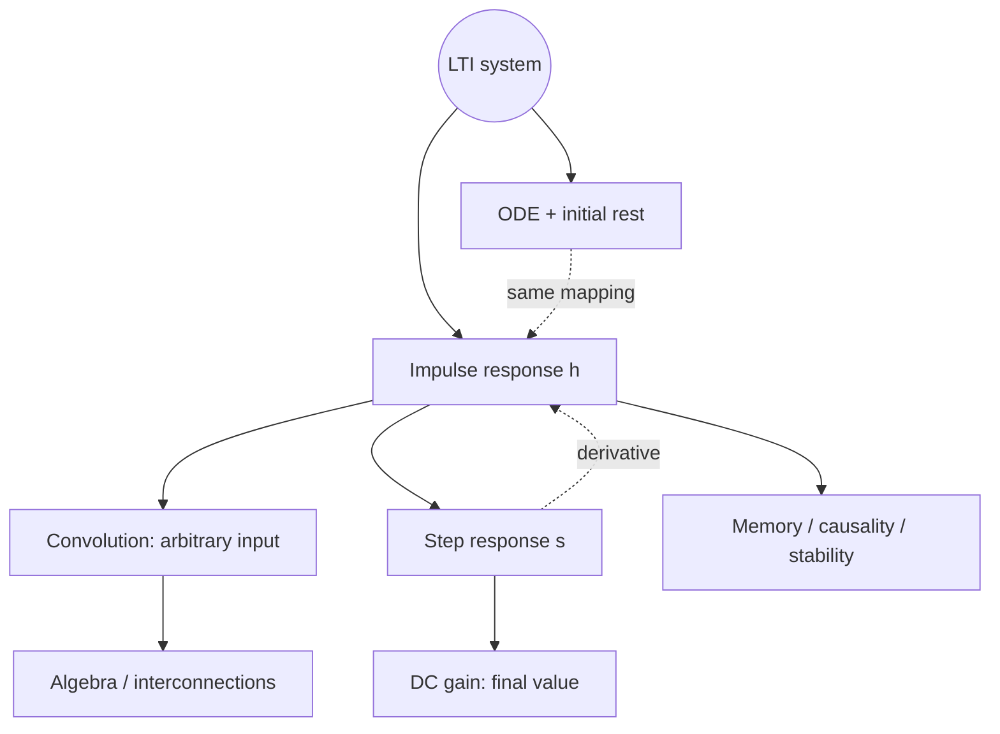

<!-- AI-assisted restructuring: Ch6 §§6.1–6.5; lecture slides; “解释第一题 integrals”, 23 Oct. No exercise-completion claim. -->

# Chapter 6 — LTI and Convolution

<a id="map"></a>



[Responses](#lti) · [Convolution](#convolution) · [Properties](#properties) · [ODE](#ode) · [Methods](./chapter-6-representative-problems.md)

---

<a id="lti"></a>

## System → Responses

```math
\boxed{h=S\delta}
\qquad
\boxed{y=Sx=x*h}
```

$S$: rule · $h$: fixed system signature · $x$: chosen input · $y$: output

```math
\delta\xrightarrow{S}h
\qquad u\xrightarrow{S}s
\qquad x\xrightarrow{S}y
```

Response name: **test input**, not output shape · $h\ne\delta$ generally · $s\ne u$ generally

```math
S\longleftrightarrow h
```

One LTI mapping ↔ one impulse response · not inverse input recovery

↔ [Ch3 notation](./chapter-3-systems-and-properties.md#system)

<a id="responses"></a>
<a id="step"></a>

**Step response: accumulated $h$**

```math
\boxed{s(t)=(u*h)(t)=\int_{-\infty}^{t}h(\tau)\,d\tau}
\qquad \boxed{h(t)=s'(t)}
```

$h(t)$: instantaneous accumulation rate · $s(t)$: accumulated signed area

```math
s(t_2)-s(t_1)=\int_{t_1}^{t_2}h(\tau)\,d\tau
```

$h=0$ → **no further change**, not $s=0$


$h(3)=0$ · $s(3)=2$ · no new area ≠ no retained area

**Two routes**

```math
u*h=h*u=\int_{-\infty}^{t}h(\tau)\,d\tau
```

```math
I(\delta*h)=(I\delta)*h=u*h=s\Rightarrow Ih=s
```

```math
D(u*h)=(Du)*h=\delta*h=h
```

$s'\to h$, **not** $s\to u$ · jumps in $s$ → impulses in $h$

↔ [Convolution calculus](#convolution-algebra) · [Ch2 step / delta](./chapter-2-signals-and-properties.md#elementary-signals) · [example](./chapter-6-representative-problems.md#accumulation)

<a id="dc-gain"></a>

**DC gain: final accumulated value**

Stable LTI · sustained input $Au$

```math
\boxed{K_{\mathrm{DC}}=\lim_{t\to\infty}s(t)=\int_{-\infty}^{\infty}h(\tau)\,d\tau}
\qquad \lim_{t\to\infty}y(t)=AK_{\mathrm{DC}}
```

$h$: whole signal → $\int h$: **one scalar**

Final output **height**, not output area $\int s$ · signed area, no absolute value
Same gain ≠ same system / transient · no finite final value → no finite step-defined gain

---

<a id="convolution"></a>

## Convolution

```math
\boxed{y(t)=\int_{-\infty}^{\infty}x(\tau)h(t-\tau)\,d\tau}
```

**$t$: output coordinate · $\tau$: integration coordinate**

```math
t=2:\quad y(2)=\int_{-\infty}^{\infty}x(\tau)h(2-\tau)\,d\tau
```

Fixed $t$ → sweep **all $\tau$** → one number $y(t)$
Vary $t$ → repeat → whole output signal

$\tau$: dummy name, integrated away · $t$: retained in answer
Any $t\in\mathbb R$ · no requirement $t>0$ or $y(t)>0$

**Graphical calculation**

```math
h(\tau)\longrightarrow h(-\tau)\longrightarrow h(t-\tau)
```

Reverse → shift by $t$ → multiply by $x(\tau)$ → integrate product

Product’s **signed area** · not either original signal’s area
Unit-height rectangles only → overlap length

↔ [Ch2 time transforms](./chapter-2-signals-and-properties.md#time-transform)

**Integration limits: overlap**

```math
x(\tau)\ne0:\ a\le\tau\le b,\qquad
h(v)\ne0:\ c\le v\le d
```

```math
c\le t-\tau\le d\iff t-d\le\tau\le t-c
```

```math
\boxed{L=\max(a,t-d),\qquad U=\min(b,t-c)}
```

$L<U$: integrate $L\to U$ · $L>U$: zero overlap
$t$-breakpoints: changing active bounds · not arbitrary positivity conditions

[Moving-window example / derivative proof](./chapter-6-representative-problems.md#window)

<a id="integrator"></a>

**Integrator: $h=u$**

```math
u(t-\tau)=1\iff\tau\le t
```

```math
(x*u)(t)=\int_{-\infty}^{t}x(\tau)\cdot1\,d\tau
+\int_t^\infty x(\tau)\cdot0\,d\tau
=\boxed{\int_{-\infty}^{t}x(\tau)\,d\tau}
```

Arbitrary input accumulated · [step response](#step): same calculation, $x$ replaced by $h$

<a id="decomposition"></a>

**Why LTI → convolution**

```math
\Delta=\frac{1}{n},\qquad
\delta_n(t)=
\begin{cases}
n,&|t|<\frac{1}{2n},\\
0,&\text{otherwise}
\end{cases}
```

Unit area · narrow pulses → signal approximation

```math
x(t)\approx\sum_i x(i\Delta)\Delta\,\delta_n(t-i\Delta)
```

```math
h_n=S\delta_n,\qquad
y(t)\approx\sum_i x(i\Delta)\Delta\,h_n(t-i\Delta)
\longrightarrow\int x(\tau)h(t-\tau)\,d\tau
```

Linearity → weighted sum · TI → matching shifts · suitable limit → integral
Rigorous limit: later · context: room echoes / matched filtering / frequency analysis

---

<a id="properties"></a>
<a id="convolution-algebra"></a>
<a id="inheritance"></a>

## Algebra → Systems

$S_i x=x*h_i$ · well-defined integrals / compositions

**Cascade / parallel**

```math
S_2S_1x=x*(h_1*h_2),\qquad
(S_1+S_2)x=x*(h_1+h_2)
```

Cascade → convolve responses · parallel → add responses

```math
h_1*h_2=h_2*h_1,\qquad
(h_1*h_2)*h_3=h_1*(h_2*h_3)
```

Commutativity → reorder · associativity → regroup · **LTI pairs**, not general systems

```math
h_1*(h_2+h_3)=h_1*h_2+h_1*h_3
```

```math
a(h_1*h_2)=(ah_1)*h_2=h_1*(ah_2)
```

Distribute over parallel · movable gain · scalar **once**

↔ [Ch3 interconnections](./chapter-3-systems-and-properties.md#interconnection)

**Calculus**

```math
D(x*h)=(Dx)*h=x*(Dh)
```

```math
I(x*h)=(Ix)*h=x*(Ih)
```

Differentiate / integrate **one factor**, not both · no product-rule sum
Admissible LTI compositions: $D\circ S=S\circ D$, $I\circ S=S\circ I$
Ordinary regularity / convergence · impulses: distributions

<a id="inverse"></a>

**Identity / inverse**

```math
x*\delta=x,\qquad h=k\delta\Rightarrow y=kx
```

Constant **gain** ≠ constant **$h$**

```math
h*h_{\mathrm{inv}}=\delta
\iff SS^{-1}=S^{-1}S=P_1
```

Convolution inverse ≠ $\frac{1}{h(t)}$ · not always existent / causal / stable

```math
\delta(t-t_0)*\delta(t-t_1)=\delta\bigl(t-(t_0+t_1)\bigr)
```

```math
t_1=-t_0\Rightarrow\delta(t-t_0)*\delta(t+t_0)=\delta(t)
```

Delay + advance → identity · mathematical inverse ≠ real-time implementation

[Delay example](./chapter-6-representative-problems.md#delay) · [Ch3 inverse](./chapter-3-systems-and-properties.md#invertibility)

<a id="h-tests"></a>

**Read properties from $h$**

Memoryless:

```math
\boxed{h=k\delta}\iff y=kx
```

Only zero lag · nonzero impulse weight allowed · no delta derivatives

Causal:

```math
\boxed{h(\tau)=0\quad(\tau<0)}
```

```math
y(t)=\int h(\tau)x(t-\tau)\,d\tau,
\qquad \tau<0\Rightarrow t-\tau>t
```

Negative **lag** → future sample · not all negative absolute-time input

Stable — ordinary $h$, BIBO:

```math
\boxed{\|h\|_1=\int_{-\infty}^{\infty}|h(\tau)|\,d\tau<\infty}
```

Finite weighted impulses: finite absolute weights

```math
E_x<\infty\Rightarrow E_y\le\|h\|_1^{2}E_x<\infty
```

Also sufficient for Ch3 energy stability · definitions ≠ interchangeable
Stable ≠ finite-energy output for **every** input

**Three different integrals**

```math
\underbrace{\int|h|}_{\text{stability}}
\qquad \underbrace{\int h}_{\text{DC gain}}
\qquad \underbrace{\int|x|^{2}}_{\text{signal energy}}
```

↔ [Ch3 stability](./chapter-3-systems-and-properties.md#stability)

---

<a id="ode"></a>

## ODE ↔ LTI

**RC: circuit → equation**


```math
\frac{v_{\mathrm{in}}-v_C}{R}=C\frac{dv_C}{dt}
\Rightarrow
Dv_C+\frac{1}{RC}v_C=\frac{1}{RC}v_{\mathrm{in}}
```

```math
v_{\mathrm{in}}=0\Rightarrow v_C(t)=Ae^{-t/(RC)}
```

ODE: evolution law · initial voltage: unique trajectory
Switch at $0$: post-switch law ≠ model of entire past

<a id="ode-lti"></a>

**Constant coefficients + compatible initial rest**

```math
y'+ay=bx
```

```math
(\alpha y_1+\beta y_2)'+a(\alpha y_1+\beta y_2)
=b(\alpha x_1+\beta x_2)
```

```math
\frac{d}{dt}y(t-d)+ay(t-d)=bx(t-d)
```

Superposition + unchanged shifted equation → LTI
Nonzero initial state → extra natural response · causality alone ≠ specified initial voltage

```math
\boxed{\text{ODE}\longleftrightarrow h\longleftrightarrow y=x*h}
```

Same mapping, different representations · Laplace: derive $h$ later

**Feedback: derivative → integrator → state**

```math
Dv_C=\frac{1}{RC}v_{\mathrm{in}}-\frac{1}{RC}v_C
```


Gain → subtraction → integration · initial charge → integrator state
Ideal differentiator: mathematical model ≠ perfect physical implementation

[RC example](./chapter-6-representative-problems.md#rc) · [Ch3 feedback](./chapter-3-systems-and-properties.md#interconnection)

---

[Methods](./chapter-6-representative-problems.md) · [Ch2](./chapter-2-signals-and-properties.md) · [Ch3](./chapter-3-systems-and-properties.md)
