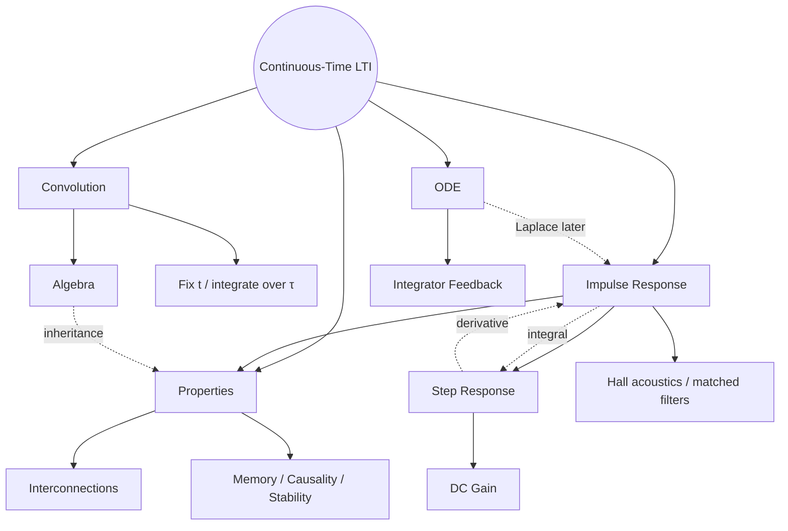

<!-- AI-assisted abstraction: Signals_and_System_02Oct.pdf, Ch. 6 §§6.1–6.5, pp. 99–108; SnS___Chapter_6.pdf, slides 1–26; reading discussion. Regularity/convergence assumptions retained; no exercise-completion claim. -->

# Chapter 6 — LTI and Convolution

---

<a id="map"></a>

## Map



Jump: [Convolution](#convolution) · [LTI representation](#lti) · [Properties](#properties) · [Responses](#responses) · [ODE](#ode)

---

<a id="convolution"></a>

## Convolution

```math
\boxed{(x*h)(t)=\int_{-\infty}^{\infty}x(\tau)h(t-\tau)\,d\tau}
```

- $*$: signal × signal → signal; not pointwise multiplication
- $t$: fixed observation time / shift
- $\tau$: integration variable; entire time axis

```math
h(\tau)\ \longrightarrow\ h(-\tau)\ \longrightarrow\ h(t-\tau)
```

Reverse → shift → pointwise product → signed area → one output value

```math
\boxed{t=t_{0}:\quad y(t_{0})=\int_{-\infty}^{\infty}x(\tau)h(t_{0}-\tau)\,d\tau}
```

Changing $t$ → changing product → changing integral → full output curve

Unit rectangles only: integral = overlap length · general signals: weighted, signed area

↔ [Ch2 time transforms](./chapter-2-signals-and-properties.md#time-transform)

<a id="convolution-algebra"></a>

**Algebra → [system inheritance](#inheritance)**

```math
x*h=h*x,\qquad x*(h*g)=(x*h)*g
```

```math
x*(h+g)=x*h+x*g
```

```math
a(x*h)=(ax)*h=x*(ah)
```

```math
x*\delta=x,\qquad x*h=\delta\Rightarrow h=x_{*}^{-1}
```

Convolution inverse: possible nonexistence · not $1/x(t)$

```math
D(x*h)=(Dx)*h=x*(Dh)
```

```math
I(x*h)=(Ix)*h=x*(Ih)
```

One differentiated / integrated factor · no product-rule sum · scalar applied once

Well-defined integrals / derivatives / compositions; impulses in distribution sense

---

<a id="lti"></a>

## LTI Representation

```math
\boxed{h=S\delta},\qquad \boxed{y=Sx=x*h}
```

- $S$: fixed rule; $x$: chosen input; $y$: output
- $h$: whole impulse-response signal; not eigenvalue
- response name → input type; not output shape
- fixed $S$ → fixed $h$; changing $x$ → changing $y$

```math
S\longleftrightarrow h
```

Same $h$ → same LTI mapping · not a claim of invertibility $x\leftrightarrow y$

↔ [Ch3 system notation](./chapter-3-systems-and-properties.md#system) · [LTI building blocks](./chapter-3-systems-and-properties.md#lti-building-blocks)

**Context**

Operating-region linear approximation · approximately unchanged system during experiment

- hall: short shot ≈ impulse; direct sound + reflections → $h$
- dry recording $*h$ → simulated reverberation
- matched filtering: radar / sonar / gravitational-wave detection
- CNN: sliding local computations
- time-domain convolution → frequency-domain analysis

<a id="decomposition"></a>

**Interpretation**

```math
\Delta=\frac1n,\qquad \tau_i=i\Delta,\qquad
\delta_n(t)=
\begin{cases}
n,&-\frac1{2n}\le t<\frac1{2n},\\
0,&\text{otherwise}.
\end{cases}
```

Unit area · height $n$ · width $\Delta$

```math
x(t)\approx\sum_i x(\tau_i)\Delta\,\delta_n(t-\tau_i)
```

```math
h_n=S\delta_n,\qquad
y(t)\approx\sum_i x(\tau_i)\Delta\,h_n(t-\tau_i)
```

Linear → scaling / addition · TI → shifted response · suitable limit → convolution

PPT slice: $dy(t,\tau)=x(\tau)h(t-\tau)\,d\tau$

Rigorous limiting proof: deferred · response-weighted slice sum

<a id="integrator"></a>

**Integrator: $h=u$**

```math
u(t-\tau)=
\begin{cases}
1,&\tau\le t,\\
0,&\tau>t.
\end{cases}
```

```math
y(t)=\int_{-\infty}^{t}x(\tau)\cdot1\,d\tau
+\int_t^{\infty}x(\tau)\cdot0\,d\tau
=\boxed{\int_{-\infty}^{t}x(\tau)\,d\tau}
```

↔ [Ch2 step / impulse](./chapter-2-signals-and-properties.md#elementary-signals) · [response integration](#step)

---

<a id="properties"></a>

## Properties

<a id="inheritance"></a>

**Convolution algebra ↔ LTI interconnection**

$S_i x=x*h_i$ · admissible compositions

| Convolution | Systems |
|---|---|
| $h_1\ast h_2$ | cascade $S_2S_1$ |
| $h_1+h_2$ | parallel $S_1+S_2$ |
| $h_1\ast h_2=h_2\ast h_1$ | $S_2S_1=S_1S_2$ |
| $(h_1\ast h_2)\ast h_3=h_1\ast(h_2\ast h_3)$ | associative cascade |
| $h_1\ast(h_2+h_3)=h_1\ast h_2+h_1\ast h_3$ | cascade distributes over parallel |
| $a(h_1\ast h_2)=(ah_1)\ast h_2=h_1\ast(ah_2)$ | movable fixed gain $P_a$ |
| $\delta$; $k\delta$ | identity $P_1$; gain $P_k$ |
| $h\ast h_{\mathrm{inv}}=\delta$ | $SS^{-1}=S^{-1}S=P_1$ |

↔ [convolution algebra](#convolution-algebra) · [Ch3 interconnections](./chapter-3-systems-and-properties.md#interconnection)

Inherited algebra ≠ automatic memorylessness / causality / stability / invertibility

LTI pairs only · general systems: no guaranteed commutativity

Associativity → regrouping · commutativity → reordering

```math
D\circ S:\ (Dx)*h=x*(Dh),\qquad
I\circ S:\ (Ix)*h=x*(Ih)
```

<a id="inverse"></a>

**Identity / inverse**

```math
h=\delta\Rightarrow y=x,\qquad h=k\delta\Rightarrow y=kx
```

Constant gain $\ne$ constant impulse response

```math
\delta(t-t_0)*\delta(t-t_1)=\delta\bigl(t-(t_0+t_1)\bigr)
```

```math
t_1=-t_0\Rightarrow\delta(t-t_0)*\delta(t+t_0)=\delta(t)
```

Delay + advance → identity · time shifts add; not momentum

Mathematical inverse ≠ causal real-time implementation

↔ [Ch3 inverse](./chapter-3-systems-and-properties.md#invertibility) · [delay method](./chapter-6-representative-problems.md#delay)

<a id="h-tests"></a>

**Tests from $h$**

```math
\text{Memoryless LTI}:\quad h=k\delta\quad\Longleftrightarrow\quad y=kx
```

Zero away from $0$ ≠ zero impulse weight · fixed gain: no memory

```math
\text{Causal}:\quad h(t)=0\quad(t<0)
```

```math
y(t)=\int_{-\infty}^{\infty}h(\tau)x(t-\tau)\,d\tau,
\qquad \tau<0\Rightarrow t-\tau>t
```

Negative lag → future input · not deletion of all absolute negative-time input

```math
\|h\|_1=\int_{-\infty}^{\infty}|h(\tau)|\,d\tau<\infty
```

Ordinary impulse responses: BIBO stability criterion · finite weighted impulses: finite absolute weights

```math
E_x<\infty\quad\Rightarrow\quad
E_y\le\|h\|_1^{2}E_x<\infty
```

Also sufficient for Ch3 finite-energy stability · definitions not interchangeable

$\int|h|$ ≠ $\int|h|^{2}$ · stable ≠ finite-energy output for every input

↔ [Ch3 property tests](./chapter-3-systems-and-properties.md#properties) · [stability definitions](./chapter-3-systems-and-properties.md#stability)

---

<a id="responses"></a>

## Responses

<a id="step"></a>

**Impulse → step**

```math
\delta\xrightarrow{S}h,\qquad u\xrightarrow{S}s
```

$S$: system · $s$: step-response signal · $u$ input ≠ $s$ output

```math
s=u*h=h*u
=\boxed{\int_{-\infty}^{t}h(\tau)\,d\tau}
```

Alternate P8 route:

```math
I(\delta*h)=(I\delta)*h=u*h=s
\quad\Rightarrow\quad Ih=s
```

```math
\boxed{h=Ds},\qquad
s(t_2)-s(t_1)=\int_{t_1}^{t_2}h(\tau)\,d\tau
```

$h(t)$: current accumulation rate · $s(t)$: accumulated result

$h=0$ over an interval → constant $s$; not necessarily zero

Output differentiation ≠ original system differentiation · jumps → impulses


↔ [Ch2 step derivative](./chapter-2-signals-and-properties.md#elementary-signals) · [accumulation method](./chapter-6-representative-problems.md#accumulation)

<a id="dc-gain"></a>

**Step → DC gain**

Stable LTI · sustained unit input · final output

```math
\boxed{K_{\mathrm{DC}}=\lim_{t\to\infty}s(t)
=\int_{-\infty}^{\infty}h(\tau)\,d\tau}
```

```math
x=Au\quad\Rightarrow\quad \lim_{t\to\infty}y(t)=A K_{\mathrm{DC}}
```

- full $h$: complete system information
- $\int h$: one scalar; signed area / steady gain
- same DC gain ≠ same system / transient
- not $\int s$; not energy; no absolute value
- no finite final value → no finite step-defined DC gain

Stability: $\int|h|$ · DC gain: $\int h$ · signal energy: $\int|x|^{2}$

---

<a id="ode"></a>

## ODE Representation

**RC**


```math
\frac{v_{\mathrm{in}}-v_C}{R}=i=C\frac{dv_C}{dt}
```

```math
Dv_C+\frac1{RC}v_C=\frac1{RC}v_{\mathrm{in}},
\qquad D=\frac{d}{dt}
```

```math
v_{\mathrm{in}}=0\Rightarrow v_C(t)=A e^{-t/(RC)}
```

ODE → evolution law · initial state → unique trajectory

$v_C(0)$: stored history · switch at $0$: post-switch ODE need not model past

<a id="ode-lti"></a>

**Linear constant coefficients + initial rest**

```math
y'+ay=bx
```

```math
(\alpha y_1+\beta y_2)'+a(\alpha y_1+\beta y_2)
=b(\alpha x_1+\beta x_2)
```

```math
\frac{d}{dt}y(t-d)+ay(t-d)=bx(t-d)
```

Superposition + unchanged coefficients under shift → LTI

Causal solution / compatible boundary conditions · causality alone ≠ specified initial voltage

Nonzero initial state → extra natural response · fixed-start experiment ≠ automatic whole-axis TI

```math
\text{ODE}\longleftrightarrow h\longleftrightarrow y=x*h
```

ODE: particular LTI representation · Laplace → derive $h$ later

**Integrator feedback**

```math
Dv_C=\frac1{RC}v_{\mathrm{in}}-\frac1{RC}v_C
```


Gain → subtraction → derivative → integration → voltage

Integrator initial state: $v_C(0)$ · ideal differentiation: practical limitations

↔ [Ch3 feedback](./chapter-3-systems-and-properties.md#interconnection) · [ODE method](./chapter-6-representative-problems.md#rc)

---

[Representative methods](./chapter-6-representative-problems.md) · [Ch2 signals](./chapter-2-signals-and-properties.md) · [Ch3 systems](./chapter-3-systems-and-properties.md)
