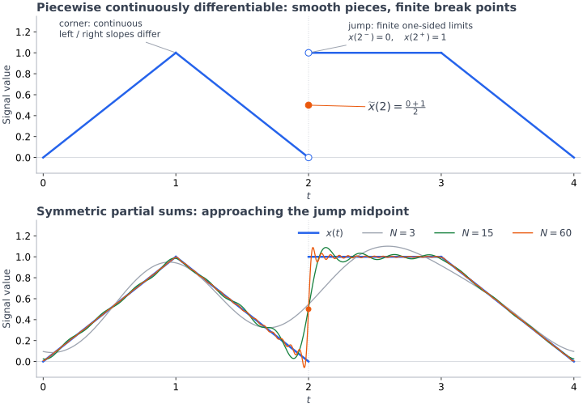

<!-- AI-assisted partial note: Signals_and_System_02Oct.pdf, pp. 115-120, through convergence; user's source-reading reasoning sequence. Orthogonality derivation: finite sums; extension to infinite series requires justification of termwise integration. -->

# Chapter 7 — Fourier Analysis

## Fourier Series

```math
\boxed{
\underbrace{
x(t)=\underbrace{\sum_{k=-\infty}^{\infty}
\underbrace{x_{k}}_{\text{coefficient}}
\underbrace{e^{j2\pi kf_{0}t}}_{\text{frequency }kf_{0}}}_{\text{Fourier series}}
}_{\text{synthesis equation}}
}
```

```math
x_{k}\in\mathbb C,\qquad k=0,\pm1,\pm2,\ldots,\qquad
f_{0}=\frac{1}{T_{0}},\qquad t\in\mathbb R
```

<a id="harmonics"></a>

**Period → harmonics → weighted sum**

```math
x(t+T_{0})=x(t),\qquad
\phi_{k}(t)=e^{j2\pi kf_{0}t},\qquad
\boxed{f_{k}=kf_{0}}
```

```math
\begin{aligned}
k=0&:\quad \phi_{0}(t)=1 &&\text{DC / offset}\\
k=\pm1&:\quad e^{\pm j2\pi f_{0}t} &&\text{fundamental pair}\\
k=\pm2&:\quad e^{\pm j2\pi(2f_{0})t} &&\text{second harmonic pair}
\end{aligned}
```

```math
\phi_{k}(t+T_{0})=\phi_{k}(t)\underbrace{e^{j2\pi k}}_{1}
=\phi_{k}(t),\qquad T_{k}=\frac{T_{0}}{|k|}\quad(k\ne0)
```

```math
\underbrace{\cos(2\pi t)}_{T=1\,\mathrm{s}}
+\underbrace{\tfrac12\cos(4\pi t)}_{T=\frac12\,\mathrm{s}}
\quad\xrightarrow{\ t\mapsto t+1\ }\quad\text{same sum}
```

```math
T_{0}\longrightarrow\{kf_{0}:k\in\mathbb Z\},
\qquad x_{k}=0\longrightarrow\text{absent component}
```

```math
\underbrace{\{x_{k}\}\longrightarrow x(t)}_{\text{synthesis}}
\qquad
\underbrace{x(t)\longrightarrow\{x_{k}\}}_{\text{analysis}}
```

Constant: $\forall T>0,\ x(t+T)=x(t)$ → no smallest period; arbitrary $T_{0}>0$

↔ [Periodic signals / complex exponential](./chapter-2-signals-and-properties.md)

<a id="coefficients"></a>

**Coefficient → magnitude / phase**

```math
\boxed{x_{k}=|x_{k}|e^{j\phi_{k}}}
\quad\Longrightarrow\quad
x_{k}e^{j2\pi kf_{0}t}
=\underbrace{|x_{k}|}_{\text{magnitude}}
e^{j(2\pi kf_{0}t+\underbrace{\phi_{k}}_{\text{phase offset}})}
```

$x_{k}\ne0:\ \phi_{k}=\angle x_{k}$ · phase inside coefficient

Grid voltage: fundamental + higher harmonics → distortion; higher-harmonic contribution relative to fundamental

<a id="real-signals"></a>

**Real signal → conjugate pairs → real cosines**

```math
x:\mathbb R\to\mathbb R
\quad\Longrightarrow\quad
\boxed{x_{-k}=x_{k}^{\ast}}
\quad\Longrightarrow\quad
\begin{aligned}
|x_{-k}|&=|x_{k}|\\
\angle x_{-k}&\equiv-\angle x_{k}\pmod{2\pi}\\
x_{0}&\in\mathbb R
\end{aligned}
```

**Real-valued ≠ even waveform · conjugate symmetry ≠ equal coefficients**

```math
\boxed{x_{k}=a+jb\quad\Longrightarrow\quad x_{-k}=a-jb}
\qquad x_{-k}=x_{k}\iff x_{k}\in\mathbb R
```

Phases: nonzero coefficients only

```math
x_{15}=\frac{\sqrt3}{40}-\frac{j}{40},\qquad
x_{-15}=\frac{\sqrt3}{40}+\frac{j}{40}=x_{15}^{\ast}\ne x_{15}
```

```math
\begin{aligned}
x(t)
&=x_{0}+\sum_{k=1}^{\infty}
\left(x_{k}e^{j2\pi kf_{0}t}+x_{k}^{\ast}e^{-j2\pi kf_{0}t}\right)\\
&=x_{0}+2\sum_{k=1}^{\infty}\mathrm{Re}\left\{x_{k}e^{j2\pi kf_{0}t}\right\}\\
&=\boxed{x_{0}+\sum_{k=1}^{\infty}
\underbrace{2|x_{k}|}_{\text{cosine amplitude}}
\cos\left(2\pi kf_{0}t+\underbrace{\angle x_{k}}_{\text{cosine phase}}\right)}.
\end{aligned}
```

Cosine form: nonzero pairs; zero pairs omitted

```math
\underbrace{2\cos\theta}_{\text{amplitude }2}
=2\frac{e^{j\theta}+e^{-j\theta}}{2}
=\underbrace{e^{j\theta}+e^{-j\theta}}_{\text{coefficients }1,1}
```

```math
3+2\cos(2\pi t)
\quad\Longrightarrow\quad x_{0}=3,\quad x_{1}=x_{-1}=1
```

Complex-valued counterexample:

```math
x(t)=e^{j2\pi t}:\qquad x_{1}=1,\quad x_{-1}=0
```

---

## Fourier Series Analysis

**Target: extract the coefficient**

$$
x(t)=\cdots+
\underbrace{x_{k}}_{\text{unknown coefficient}}
\underbrace{e^{j2\pi kf_{0}t}}_{\text{known component}}
+\cdots
$$

$$
\underbrace{x_{k}e^{j2\pi kf_{0}t}}_{\text{target component}}
\;\times\;
\underbrace{e^{-j2\pi kf_{0}t}}_{\text{cancel its exponential}}
=\boxed{x_{k}}
$$

```math
\int_{0}^{T_{0}}|x(t)|\,dt\lt\infty,
\qquad
\boxed{x_{k}=\frac{1}{T_{0}}\int_{0}^{T_{0}}
x(t)e^{-j2\pi kf_{0}t}\,dt}
```

Fixed $k$: target coefficient · $n$: component index

```math
\underbrace{x_{n}e^{j2\pi nf_{0}t}}_{\text{component }n}
\underbrace{e^{-j2\pi kf_{0}t}}_{\text{target }k}
=x_{n}e^{j2\pi(n-k)f_{0}t}
```

```math
\frac{1}{T_{0}}\int_{0}^{T_{0}}
x_{n}e^{j2\pi(n-k)f_{0}t}\,dt
=\begin{cases}
x_{k},&n=k\\
0,&n\ne k
\end{cases}
```

```math
x(t)=3+2e^{j2\pi t}+5e^{j4\pi t},\qquad T_{0}=1,\quad k=1
```

```math
\begin{aligned}
x_{1}
&=\int_{0}^{1}x(t)e^{-j2\pi t}\,dt\\
&=\int_{0}^{1}\left(3e^{-j2\pi t}+2+5e^{j2\pi t}\right)dt\\
&=\underbrace{0}_{\text{one cycle}}+
\underbrace{2}_{\text{constant}}+
\underbrace{0}_{\text{one cycle}}=\boxed{2}.
\end{aligned}
```

```math
e^{j2\pi t}=\cos(2\pi t)+j\sin(2\pi t),\qquad
\int_{0}^{1}\cos(2\pi t)dt=\int_{0}^{1}\sin(2\pi t)dt=0
```

---

**Sinusoid → visible harmonics → coefficient check**

```math
A\sin(2\pi mf_{0}t+\phi)
=\underbrace{\frac{Ae^{j\phi}}{2j}}_{x_{m}}e^{j2\pi mf_{0}t}
+\underbrace{-\frac{Ae^{-j\phi}}{2j}}_{x_{-m}}e^{-j2\pi mf_{0}t},
\qquad m=1,2,\ldots
```

$f_{0}$: whole signal's fundamental frequency · $m$: harmonic index · $A$: amplitude, not index

```math
x(t)=\sin(2\pi f_{0}t)
\quad\Longrightarrow\quad
x_{k}=\frac{f_{0}}{2j}\int_{0}^{1/f_{0}}
\left[e^{-j2\pi(k-1)f_{0}t}-e^{-j2\pi(k+1)f_{0}t}\right]dt
```

$k\pm1$: this signal's $\pm f_{0}$ components; not a general analysis formula

```math
\begin{aligned}
k=1&:\quad k-1=0
&&\Rightarrow x_{1}=\frac{f_{0}}{2j}
\underbrace{\int_{0}^{1/f_{0}}1\,dt}_{1/f_{0}}=-\frac{j}{2}\\
k=-1&:\quad k+1=0
&&\Rightarrow x_{-1}=\frac{j}{2}\\
k\notin\{-1,1\}&:\quad k-1\ne0,\ k+1\ne0
&&\Rightarrow x_{k}=0
\end{aligned}
```

Practice: [mixed harmonics → coefficients / plot](./chapter-7-representative-problems.md#coefficients)

Match exponent → read coefficient

```math
e^{j(2\pi ft+\phi)}
=\underbrace{e^{j\phi}}_{\text{constant coefficient factor}}e^{j2\pi ft}
```

---

<a id="convergence"></a>

## Convergence

```math
\underbrace{x_N(t)=\sum_{k=-N}^{N}x_ke^{j2\pi kf_0t}}_{\text{symmetric index range}}
\quad\xrightarrow{N\to\infty}\quad
\widetilde{x}(t)\stackrel{?}{=}x(t)
```

**Coefficient existence**

```math
e^{-j\theta}=\cos\theta-j\sin\theta
\quad\Longrightarrow\quad
\boxed{|e^{-j\theta}|=\sqrt{\cos^{2}\theta+\sin^{2}\theta}=1},
\qquad\theta=2\pi kf_{0}t
```

Changing angle · unit magnitude

```math
\left|\int g(t)\,dt\right|\le\int|g(t)|\,dt
\qquad
\underbrace{|3-2|}_{1}\le\underbrace{|3|+|-2|}_{5}
```

```math
\begin{aligned}
|x_{k}|
&=\frac{1}{T_{0}}\left|\int_{0}^{T_{0}}x(t)e^{-j2\pi kf_{0}t}\,dt\right|\\
&\le\frac{1}{T_{0}}\int_{0}^{T_{0}}
\underbrace{|x(t)e^{-j2\pi kf_{0}t}|}_{|x(t)|}\,dt
\lt\infty.
\end{aligned}
```

Absolute integrability → finite coefficient for each fixed $k$; no pointwise-convergence guarantee

```math
t^{-1/2}\to\infty\ (t\to0^{+}),
\qquad \int_{0}^{1}t^{-1/2}\,dt=2
```

Unbounded amplitude ≠ divergent integral

**Sufficient condition: piecewise continuously differentiable over one period**

```math
a_0\lt a_1\lt\cdots\lt a_M=a_0+T_0,\qquad M\lt\infty
```

```math
x|_{(a_{r-1},a_r)}\text{ extends to }C^1([a_{r-1},a_r])
```

Smooth within pieces · finite break points · corners / jumps allowed

```math
x(a_r^-)=\lim_{t\to a_r^-}x(t),\qquad
x(a_r^+)=\lim_{t\to a_r^+}x(t),\qquad
|x(a_r^\pm)|\lt\infty
```

Finite left / right limits; equality not required

```math
x(a^-)=2,\quad x(a^+)=5
\quad\Longrightarrow\quad
\widetilde{x}(a)=\frac{2+5}{2},
\qquad x(a)\text{ independently assigned}

```

```math
E_{\mathrm{period}}=\int_{0}^{T_{0}}|x(t)|^{2}dt\lt\infty,\qquad
P=\frac{E_{\mathrm{period}}}{T_{0}}\lt\infty

```

Nonzero periodic signal ($P>0$): $E_{\infty}=\infty$

```math
\boxed{
\widetilde{x}(t)=
\begin{cases}
x(t),&x\text{ continuous at }t,\\
\frac{x(t^-)+x(t^+)}{2},&t\text{ a jump}.
\end{cases}}
```



**Finite sums: Gibbs phenomenon**

```math
J=|x(t_{0}^{+})-x(t_{0}^{-})|,
\qquad
\boxed{\text{peak overshoot}\longrightarrow0.08949\ldots J}
```

```math
2\to5:\qquad J=3,\qquad
\text{upper peak}\approx5+0.09(3)=5.27
```

$N\uparrow$: narrower oscillation region; persistent peak height; better approximation away from jumps

**Whole-waveform error: mean-square convergence**

```math
\underbrace{e_{N}(t)=x(t)-x_{N}(t)}_{\text{error signal}}
\quad\longrightarrow\quad
\underbrace{\int_{0}^{T_{0}}|e_{N}(t)|^{2}dt}_{\text{error energy over one period}}
```

```math
\boxed{
d(x,x_{N})=
\left(\int_{0}^{T_{0}}|x(t)-x_{N}(t)|^{2}dt\right)^{1/2}
}
```

$d$: distance between whole signals

```math
P=\frac{1}{T_{0}}\int_{0}^{T_{0}}|x(t)|^{2}dt\lt\infty
\quad\Longrightarrow\quad
\boxed{d(x,x_{N})\xrightarrow{N\to\infty}0}
```

```math
\underbrace{\frac{d(x,x_{N})^{2}}{T_{0}}}_{\text{mean-square error}}
\longrightarrow0
```

Pointwise: error at fixed $t$ · mean-square: integrated squared error

Isolated-point differences: zero error energy · Gibbs: shrinking region despite persistent peak

Function space: whole signals as elements; $d$ as distance · functional analysis: further reading

Practice: [real waveform → coefficient plot](./chapter-7-representative-problems.md#coefficients)

---

**Why sinusoidal components?**

```math
\frac{d}{dt}\cos(\omega t)
=\omega\cos\left(\omega t+\frac{\pi}{2}\right)
```

Stable LTI · sinusoidal steady state:

```math
A\cos(2\pi ft+\phi)
\xrightarrow{S}
A|H(f)|\cos\left(2\pi ft+\phi+\angle H(f)\right)
```

Same frequency · magnitude / phase changes · AC phasors

↔ [LTI / convolution](./chapter-6-lti-and-convolution.md)
