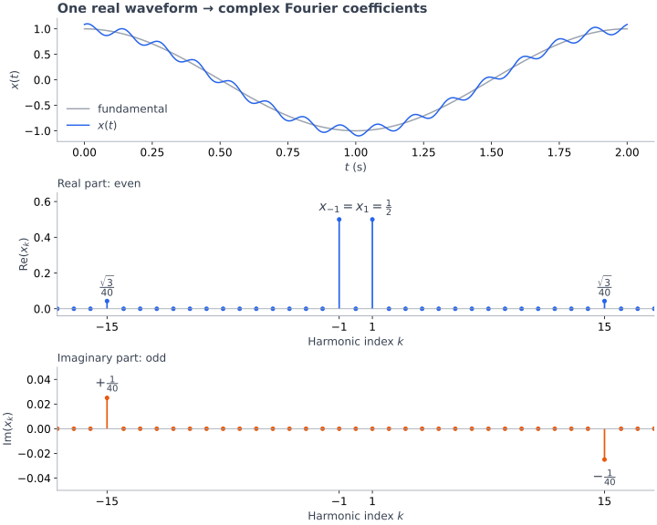

<!-- AI-assisted worked example: Signals_and_System_02Oct.pdf, Example 7.2.2 / Figure 7.2, pp. 118-120. Independently redrawn coefficient plot; convergence illustration is a separate constructed example. -->

# Chapter 7 — Representative Problems

<a id="coefficients"></a>

## Real Waveform → Complex Coefficients

↔ [Fourier series](./chapter-7-fourier.md#harmonics) · [conjugate symmetry](./chapter-7-fourier.md#real-signals) · [convergence](./chapter-7-fourier.md#convergence)

```math
x(t)=\cos(2\pi f_0t)+0.1\sin\left(2\pi15f_0t+\frac{\pi}{3}\right),
\qquad f_0=0.5\,\mathrm{Hz},\quad T_0=2\,\mathrm{s}
```

Find $x_k$; plot real / imaginary parts against $k$.

```math
\begin{aligned}
x(t)
&=\underbrace{\frac12}_{x_1}e^{j2\pi f_0t}
+\underbrace{\frac12}_{x_{-1}}e^{-j2\pi f_0t}\\
&\quad+\underbrace{\frac{0.1e^{j\pi/3}}{2j}}_{x_{15}}e^{j2\pi15f_0t}
+\underbrace{-\frac{0.1e^{-j\pi/3}}{2j}}_{x_{-15}}e^{-j2\pi15f_0t}.
\end{aligned}
```

```math
x_1=x_{-1}=\frac12,\qquad
x_{15}=\frac{\sqrt3}{40}-\frac{j}{40},\qquad
x_{-15}=\frac{\sqrt3}{40}+\frac{j}{40}
```

```math
x_k=0\quad(k\notin\{-15,-1,1,15\}),\qquad f_k=kf_0
```

**Match exponential → coefficient** · $k=-15$ ≠ negative coefficient

```math
x_{-k}=x_k^\ast
\quad\Longrightarrow\quad
\mathrm{Re}(x_{-k})=\mathrm{Re}(x_k),\qquad
\mathrm{Im}(x_{-k})=-\mathrm{Im}(x_k)
```



Top: time $t$ · bottom: index $k$, not time · stems: coefficients, not impulse heights

Real waveform ≠ even waveform · real coefficients at $\pm1$; complex conjugate coefficients at $\pm15$

