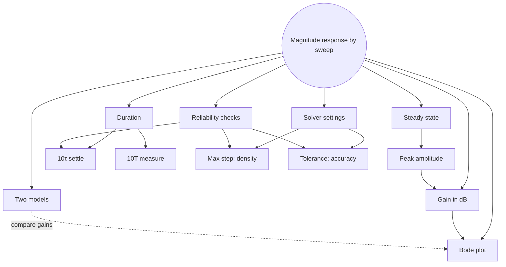

<!-- AI-assisted revision layout: "Measuring the magnitude response in Simulink" lab guide v1.1 (1 Nov 2026, Canvas: Second part of Lab 1: Training exercise for Lab 2, model BandLimitedOpAmp_2025a.slx) + user reading discussion 2026-11-09. -->
<!-- Source inconsistency: guide stop-time formula 10τ + 10/f (duration section) vs 10τ + 5/f (solver table); note uses 10τ + 10T and checks final cycles. -->

# Simulink — Measuring Magnitude Response

Simulink sweep · op amp path vs reference path

<a id="map"></a>



[Gain](#gain) · [Two models](#models) · [Steady state](#steady-state) · [Duration](#duration) · [Solver](#solver) · [Reliability](#reliability) · [Bode plot](#bode)

---

<a id="gain"></a>

## Gain in dB

```math
\large
x(t)=A_{\mathrm{in}}\sin(2\pi ft)
\ \xrightarrow{\ \mathrm{stable\ LTI}\ }\ 
y_{\mathrm{ss}}(t)=A_{\mathrm{out}}\sin(2\pi ft+\varphi)
```

Same $f$ · new amplitude · phase $\varphi$ ↔ time shift $\dfrac{\varphi}{2\pi f}$ · this lab: amplitude only

```math
\large
\boxed{|A(f)|=\frac{A_{\mathrm{out}}}{A_{\mathrm{in}}},\qquad
M(f)=20\log_{10}\!\left(\frac{A_{\mathrm{out}}}{A_{\mathrm{in}}}\right)\ \mathrm{dB}}
```

Ratio, not difference · V/V → dimensionless

<details>
<summary>Reference values · sign · convention</summary>

$\displaystyle 10\to+20\ \mathrm{dB},\quad 1\to0\ \mathrm{dB},\quad \frac{1}{\sqrt{2}}\to-3\ \mathrm{dB},\quad 0.5\to-6\ \mathrm{dB},\quad 0.1\to-20\ \mathrm{dB}.$

$\displaystyle A_{0}=10^{5}\ \Rightarrow\ 20\log_{10}10^{5}=100\ \mathrm{dB}.$

$A_{\mathrm{out}}<A_{\mathrm{in}}$ → ratio $<1$ → log $<0$ → attenuation

$A_{\mathrm{in}},A_{\mathrm{out}}>0$ always · negative dB ≠ negative voltage

Same convention both sides: peak / peak

Peak in, peak-to-peak out → ratio ×2 → spurious $+6\ \mathrm{dB}$

**Inverse: dB → ratio**

$\displaystyle r=10^{\frac{M}{20}},\qquad 0.1\ \mathrm{dB}\ \Rightarrow\ r=10^{0.005}\approx1.0116\ (\approx1.2\%).$

Order: divide by 20 → exponent of 10 · not $(0.1/20)^{10}$

</details>

↔ [dB conversion](./simulink-representative-problems.md#db)

---

<a id="models"></a>

## Two Models

Upper path: Simscape circuit (R, C, op amp) → **op amp** column

Lower path: circuit equations → transfer function block → **reference** column

```math
\large
\tau\frac{dy}{dt}(t)+y(t)=A_{0}x(t),\qquad A_{0}=10^{5}
```

Same source → both paths → one Voltage Scope, two traces · identify traces first

Each path: own $A_{\mathrm{out}}$ · common $A_{\mathrm{in}}$

<details>
<summary>Agreement: proves / does not prove</summary>

Proves: transfer function derived + implemented consistently with circuit

Only for tested inputs: tested $f$, tested amplitude

Not proved: both models sharing one wrong value (e.g. same mistyped R) · physical circuit behaviour · large-signal behaviour

**Disagreement causes**

Parameters mismatch → two different systems

Polarity reversed → 180° shift, same amplitude

Nonzero initial conditions → different transients → early mismatch, late agreement

Clipping: op amp rails in Simscape · transfer function linear, never clips

Numerical error → check before blaming models

</details>

**Source settings**

Bias $0$ · Sample time $0$ (continuous) · frequency field rad/s: `2*pi*f`

Entering $f$ in rad/s field → actual frequency $f/(2\pi)$

---

<a id="steady-state"></a>

## Steady State

```math
\large
y(t)=y_{\mathrm{transient}}(t)+y_{\mathrm{ss}}(t)
```

Gain relation: $y_{\mathrm{ss}}$ only · early peaks larger or smaller than final

Whole-run maximum ✗ → transient overshoot possible

<a id="peak-amplitude"></a>

```math
\large
\boxed{A_{\mathrm{out}}=\frac{y_{\max}-y_{\min}}{2}}\qquad\text{final 3–5 cycles}
```

Max − min → offset cancels · $y_{\max}$ alone → includes mean level

<details>
<summary>Settled? · statistics window</summary>

No systematic change: maxima · minima · mean level · period

Successive peak-to-peak agreement ≲ 1% (cycle agreement, not solver tolerance)

Repeat on neighbouring cycles · drifting → longer stop time

Periodic but clipped / distorted → unusable for sinusoidal gain

Scope zoom ≠ statistics window · cursors: read what is shown

Logged data: explicit settled window

```matlab
idx = t >= t_wait;
A = (max(y(idx)) - min(y(idx))) / 2;
```

</details>

---

<a id="duration"></a>

## Duration

```math
\large
T=\frac{1}{f},\qquad
f_{c}=10^{4}\ \mathrm{Hz},\qquad
\tau=\frac{1}{2\pi f_{c}}\approx15.9\ \mu\mathrm{s}
```

```math
\large
\boxed{t_{\mathrm{stop}}=\underbrace{10\tau}_{\mathrm{transient\ gone}}+\underbrace{10T}_{\mathrm{cycles\ to\ measure}}}
```

$\displaystyle e^{-t/\tau}\Big|_{t=10\tau}=e^{-10}\approx4.5\times10^{-5}$

<details>
<summary>Why both terms</summary>

$10\tau$ alone: settled, but nothing left to measure

Low $f$: $T\gg\tau$ · $100\ \mathrm{Hz}$: $T=10\ \mathrm{ms}$ vs $10\tau\approx0.16\ \mathrm{ms}$ → $10\tau$ < one cycle

High $f$: many cycles inside $10\tau$ → fixed cycle count alone unreliable

Stop time = simulated physical time ≠ computation time

Starting estimate for this model only · verify final cycles · other systems: other settling

</details>

↔ [trial settings table](./simulink-representative-problems.md#settings)

---

<a id="solver"></a>

## Solver Settings

Numerical ODE solution · finite steps · smooth trace ≠ accurate

**Max step → sampling density**

```math
\large
h_{\max}=\frac{T}{50}=\frac{1}{50f}
```

≈50 points per cycle · too large → peak between samples → $A_{\mathrm{out}}$ low → gain low

Wrong result → smaller step, not larger · $T/50$ starting point, not guarantee → $T/100$ check

**Tolerance → per-step accuracy**

Variable step: local error estimate each step

Error > tolerance → reject, retry same step smaller

Error ≪ tolerance → enlarge next step

Step size = outcome of tolerance, capped by $h_{\max}$

<details>
<summary>Point accurate ≠ points dense · rel / abs · fixed step</summary>

Strict tolerance + $h_{\max}=T/5$: each point accurate, ~5 points per cycle

Smooth steady sine → small error estimate → steps reach cap → peaks missed

Tolerance: accuracy · max step: density · both required

Relative tol: error ∝ state size · start `1e-4`, check `1e-5`

Absolute tol: states near zero, zero crossings, small signals

Large gain + small input → internal states ≠ displayed volts → no universal abs tol in V

Local state error ≠ final amplitude error → refinement check needed

Fixed step: $\displaystyle h\le\min\left(\frac{T}{50},\frac{\tau}{20}\right)$ · halve to check · no adaptive control

Simscape local solver: own step limit → GTA if global changes do nothing

</details>

↔ [max step vs tolerance](./simulink-representative-problems.md#step-tolerance)

---

<a id="reliability"></a>

## Reliability Checks

Representative points: low $f$ · near $f_{c}$ · high $f$

<details>
<summary>Why these three</summary>

Low $f$: long $T$ → too few cycles risk

Near $f_{c}$: curve bending → gain most sensitive

High $f$: tiny $T/50$ · low gain → small states → abs tol issues

</details>

| Check | Change | Pass |
|---|---|---|
| Settling | longer stop time, later window | gain unchanged |
| Resolution | $h_{\max}:T/50\to T/100$ | gain unchanged |
| Tolerance | rel tol ÷10; tighter abs tol | gain unchanged |

One setting at a time → cause identifiable

```math
\large
\Delta M<0.1\ \mathrm{dB}\ \Longleftrightarrow\ \frac{A'}{A}\lesssim1.012
```

Change after halving step → previous result numerical error, not circuit change

<details>
<summary>Troubleshooting</summary>

Peaks / mean still changing → run longer, later window

Few points near peaks → smaller max step · logging decimation

Repeated but distorted → input amplitude (clipping) → finer settings

Unexpected frequency / gain → Hz vs rad/s · peak vs peak-to-peak · units · correct $A_{\mathrm{in}}$

Extra Scope interpolation → no better solution

</details>

---

<a id="bode"></a>

## Bode Magnitude Plot

Horizontal: $f$ in Hz, log · vertical: dB, linear

Log axis: equal distance = equal ratio · decade: $f\times10$

Vertical log ✗ → dB already $20\log_{10}$ · log of log meaningless · $\le0$ dB unplottable

Dense points near $f_{c}=10\ \mathrm{kHz}$ (5k, 7k, 20k) → bend + −3 dB location · far from $f_{c}$: near-straight, few points

```matlab
Gop  = 20*log10(Aop./Ain);
Gref = 20*log10(Aref./Ain);
semilogx(f_Hz,Gop,'o-',f_Hz,Gref,'s-'); grid on
```

**Read from plot**

Low-frequency gain · −3 dB frequency (gain ×$\frac{1}{\sqrt{2}}$ from low-f level) · high-frequency slope (dB/decade) · two-model agreement after numerical check

---

[Problems](./simulink-representative-problems.md) · [Ch6 step response](./chapter-6-lti-and-convolution.md#responses) · [Ch7 Fourier](./chapter-7-fourier.md)
